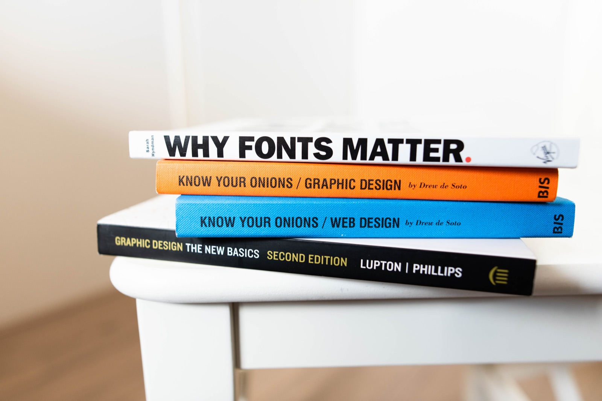

# Key Roles

So let’s start defining what UX/UI Design actually is. Well, UX Design is an umbrella term which basically means someone who is part of a the design process and realistically when designers actually start work, they begin to settle into a specific role and responsibility but there are more jobs to be done within an organisation so let’s take a look at a few now and see what you’ll be doing in the future. 

# Directors

## Creative Director

Creative Director is a term which often refers to an **individual who operates well above management level and who works alongside fellow company directors**. If you end up here. You are the boss! They decide the overall creative strategy of product line, services or product ranges and must be able to align the long term objectives of a company with the final products that are brought to market. 

---

# Management

## Project Design Managers

The project manager is usually an **experienced designers but can sometimes be an administrative figure who will liaise between company directors and staff**. They can often be referred to as Scrum Masters responsible for time management and project organisation. They are masters of the Backlog that will guide the work towards completion state whilst reporting to the bosses above. 

## Tech Leads / Design Lead

A Tech Lead, Technical Lead is for all intents and purposes is **a department head, specifically responsible for the technical inclusions of software development and design**. Although the term applies mostly to developers, it’s important to know that this term can be applied in UX as **the Design Lead**. Essentially they are the most experienced designer in the room responsible for high level implementation decisions. They work closely between both project manager and you.  

---

# Engineers

## Front End Developer

A Front End Developer is **someone who works exclusively in code** and is responsible for the implementation of website layout styles otherwise referred to as CSS. They are the specific engineers who will implement your designs and whilst they can do some design, they are very much engineers and will only in exceptionally rare cases be capable of both beautiful design work and exceptionally fluid code.   

## Back End Developer

A Back End Developer is an **engineer who creates servers**. They are like the information architectures of the engineering world, routing and implementing the raw structure of a website into a server. They very much work behind the curtain producing code that the end user will never actually see but none the less uses every day.       

## Full Stack Developer

A Full Stack Developer is a term for a **general engineer** who does both front and back end engineering. They are frequently found in design studios or multi disciplinary studios rather than large software companies as their responsibilities cover a wider range of tasks rather and specific roles.  

---

---

# UX Researchers

## Anthropologists, Sociologists and Psychologists

As large conglomerates like Meta, Apple and Google continue to try and understand the complexities of the human being, you will frequently see job offers for positions like anthropologists, sociologists and psychologists. Individuals who enjoy these soft-scientific disciplines **will formulate teams that are a part of raw research interested in early discovery and hypothesis** that will inspire future solutions and real world products which should have meaningful utility and application.  

## UX Researcher

A UX Researcher is an individual who works inside a team and is responsible for implementing a number of research methods like surveys, usability testing sessions, on the fly interviews and subject study. **They are responsible for collecting both qualitative and quantitative data**, providing user analysis and identifying patterns in user response. They implement a number of research techniques at different stages in a product sprint. These methodologies include user persona building, A/B Testing, Stakeholder Interview and Focus Group Sessions. They must be able to provide clear reports to the wider organisation which shows insight and discovery into a specific market, field or potential solution.       

## Data Analysts

A data analyst is really **an extension of the researcher who examines and interprets quantitative data to extract meaningful insights and supports data-driven design decisions**. They play a critical role in transforming raw data into actionable information that can be used by the team to streamline a product, identify user trends, and find specific problems inside a product cycle. Whilst this responsibility is often given to the researcher, in larger organisations, this responsibility plays its own crucial individual role.

## Information Architects

The position of Information Architects has become more defined in recent years **with their responsibility pertaining to the taxonomy and categorisation of sections, pages and tabs within an over all product**. More importantly, they must work closely with researchers to effectively empathise with the user and discover the most efficient and accessible ways to navigate apps. They have unbelievably strong logical skill sets and can quickly identify core functions and the priority of each functionality.      

## UX Writers

A UX Writer is an individual who works within a team and **produces the language and tone of a product**. They are preoccupied with writing simple instructional guidance to explain things whilst at the same time preserving the thematic tone and voice of the product. They must remain product orientated and work closely with product designers to understand the tone tenacity and voice of a product as well as understanding the demographic spread and the most valuable users. 

---

---

# Visual Artists

## UI Designer

A UI or User Interface Designer is the person **primarily responsible for the digital aesthetic** who will work inside a graphic interface software. Historically, they depend on design software like Figma, Sketch and Adobe Creative Cloud to create the UI. Inside larger organisations, they would receive user flows from Information Architects and their responsibility is to execute these tasks into the final screens ready for hand-off to the developers.  

## Interaction (IDX) Designer

IDX designers or Motion Graphics Designers are **responsible for animation and motion inside digital products**. They must be able to prototype effective animation which can be realised by developers. Historically, they depended on software like Blender, After Effects and Cinema 4D yet as Figma continues to become increasingly integrated, this responsibility is becoming increasingly integrated as well within UI Design job descriptions. Larger organisations will employ motion graphics designers as part of a wider advertising strategy.  

## Product Designer

Product Designers, often referred to as visual designers or industrial designers refers to product **designers who are not limited to the digital space**. They can utilise industrial software such as CAD software, 3DS Max and other software compositors to produce real world products however. This term can include UI Designers therefore, if you see a software company advertising this job go for it as it will basically mean UI design.   

## Graphic Designers

The father of the UI Designer, this responsibility was the **original job description for a User Interface designer**. Today, however there are vast differences between graphic designers and UX designs. Where Graphic designers are given free range to develop artistry for large format printing, apparel, logo design and packaging, UI design refers specifically to products for the digital space. A good UI Designer will usually have amazing graphic design skills but it isn’t the case that every graphic designer will make great UI Designs as the latter requires working within a large inter disciplinary team being able to interpret complete customer journeys and include important data points into their design decisions.

---

## Why it matters for UX

Design is a team sport. Knowing who does what helps you speak the language of the people you will work with, hand off work cleanly and see where your own strengths could take your career.

## Try it: map a real team (20 minutes)

1. Find a UX or product design job advert from a company you would like to work for.
2. List every role it mentions, or that you can infer the designer will work with.
3. Match each to a role on this page, and note who you would hand work to and receive work from.
4. Circle the role you would most like to grow into, and write one skill you need to get there.

## Media

[https://www.youtube.com/watch?v=bCG2KzfoUL0](https://www.youtube.com/watch?v=bCG2KzfoUL0)

## Resources

[What is UX Research? – Interaction Design Foundation](https://www.interaction-design.org/literature/topics/ux-research)

[What is User Experience (UX) Design? – Interaction Design Foundation](https://www.interaction-design.org/literature/topics/ux-design)

## Key takeaways

- UX design is an umbrella term; in practice designers settle into specific roles.
- Researchers, information architects, writers and UI designers each own a part of the experience.
- Engineers build what you design, so learn to hand off work they can use.
