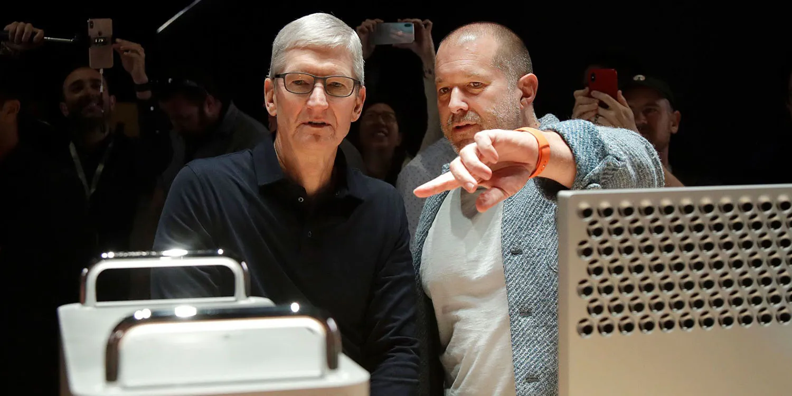
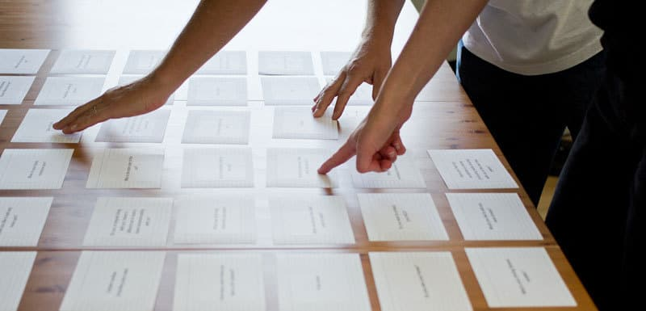
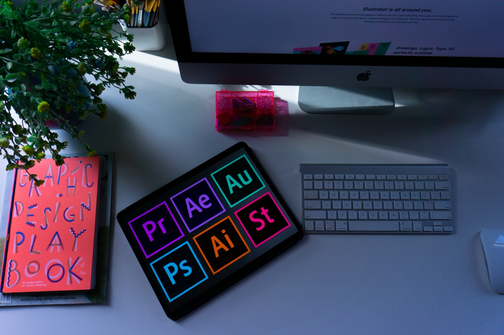

title: Key Roles
promise: UX design is an umbrella term. Who does what in a real product team, and where your own strengths could take your career.
duration: 15 minutes
topics:
- UX as an umbrella term
- Directors and managers
- Engineers
- Researchers, data analysts, information architects and UX writers
- UI, interaction, product and graphic designers
---
@title
# Key Roles
Design is a team sport.
---
@statement
**UX design** is an umbrella term.

When designers start work, they settle into a specific role, alongside many others.
---
@split
## Directors

A **Creative Director** works above management, alongside the company's other directors.

They set the creative strategy for whole product lines, and align long-term goals with what goes to market.
---
@cards
## Management

- **Project or design manager** Often a Scrum Master: owns the backlog, the timeline and the reporting
- **Design Lead** The most experienced designer in the room, making high-level decisions between the manager and you
---
@cards
## Engineers

- **Front-end developer** Works in code: turns your designs into HTML, CSS and JavaScript
- **Back-end developer** Builds the servers and data behind the screen, unseen but used every day
- **Full-stack developer** Does both, often in smaller studios
---
@section
## Research and structure
Understanding people and organising information.
---
@cards
## Researchers

- **UX researcher** Surveys, interviews and usability tests; reports patterns in qualitative and quantitative data
- **Data analyst** Turns raw numbers into insights that drive design decisions
- **Anthropologists and psychologists** Early discovery research at big companies
---
@split
## Information architect

Owns the **structure**: the sections, pages and tabs of a product, and what's called what.

Works with researchers, often through card sorting, to find the clearest way to navigate.
---
@text
## UX writer

Writes the **language and tone** of a product: buttons, instructions, errors and empty states.

Clear guidance, in the product's own voice, for its most valuable users.
---
@section
## Visual design
Making it look, move and feel right.
---
@split
## UI designer

Responsible for the **digital look**, in Figma and similar tools.

In larger teams, they turn user flows from information architects into final screens, ready to hand off to developers.
---
@cards
## Other design roles

- **Interaction designer** Animation and motion, prototyped so developers can build it
- **Product designer** Not limited to screens. In software job adverts, it usually means UI and UX design
- **Graphic designer** The original UI designer: print, packaging, logos and apparel
---
@exercise
## Who does it?

1. Runs a card sort to organise a banking app's menu
2. Rewrites "Error 402" as a helpful message
3. Builds the server that stores user accounts
4. Turns your Figma screens into CSS
5. Interviews twelve users and reports the patterns
6. Animates the onboarding screens
7. Owns the backlog and the sprint timeline
8. Sets the brand's creative direction for the next five years
---
@answers
## Check yourself

1. **Information architect**
2. **UX writer**
3. **Back-end developer**
4. **Front-end developer**
5. **UX researcher**
6. **Interaction designer**
7. **Project manager** (Scrum Master)
8. **Creative director**

Which role would you like to grow into?
