# Laws of UX

Jon Yablonski is central to the current formal understanding of what UX is. A designer, developer, and author known for his work in the field of user experience (UX) design. He has made significant contributions to the UX community, particularly through his efforts to synthesise and communicate key principles of user experience design. Yablonski is best known for creating the [Laws of UX](https://lawsofux.com), which consolidates and explains various psychological principles and heuristics that can be applied to design effective and user-friendly interfaces  

---

## Aesthetic-Usability Effect

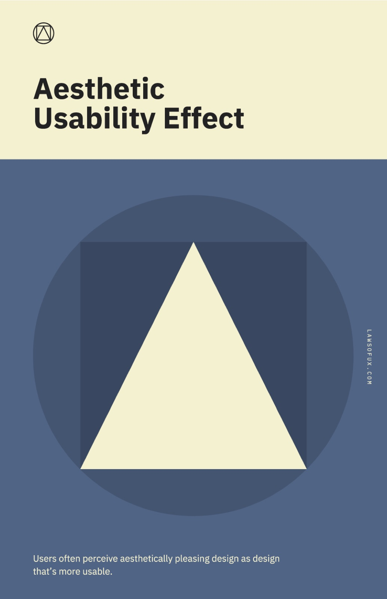

Adhere to the bias of beauty.  

---

## Hick's Law

Keep your design simple.

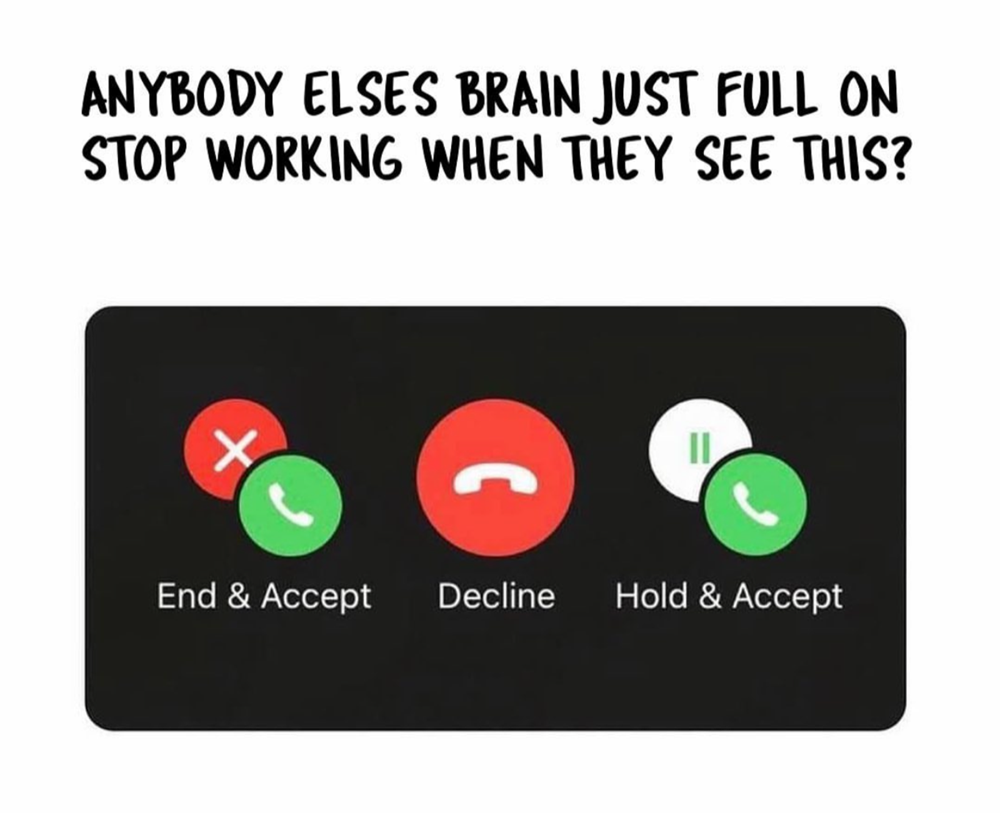

---

## Jakob's Law

Use the established language of the internet. Take credibility from established design systems. They are the rule. You are the exception. 

## Law of Common Region

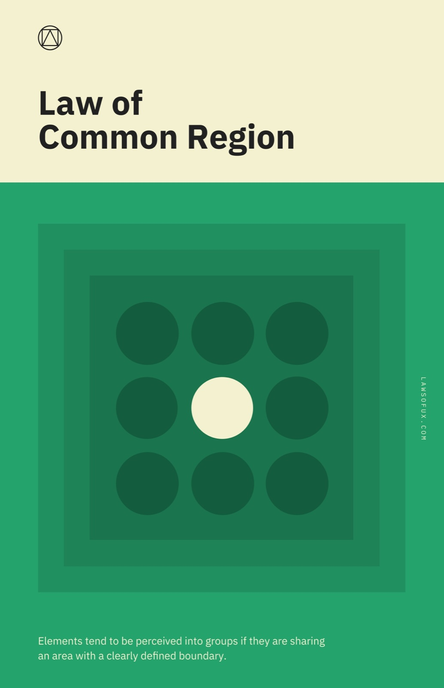

Please discuss the above law in reference to the below UI.

---

## Law of Proximity

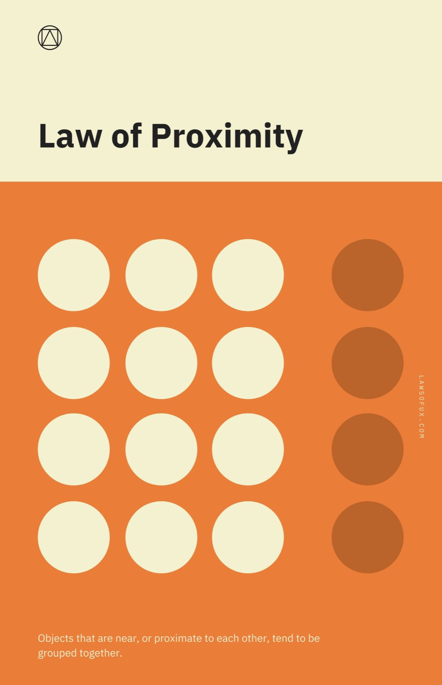

How many groups do you see in the CNN Footer below?

---

## Law of Similarity

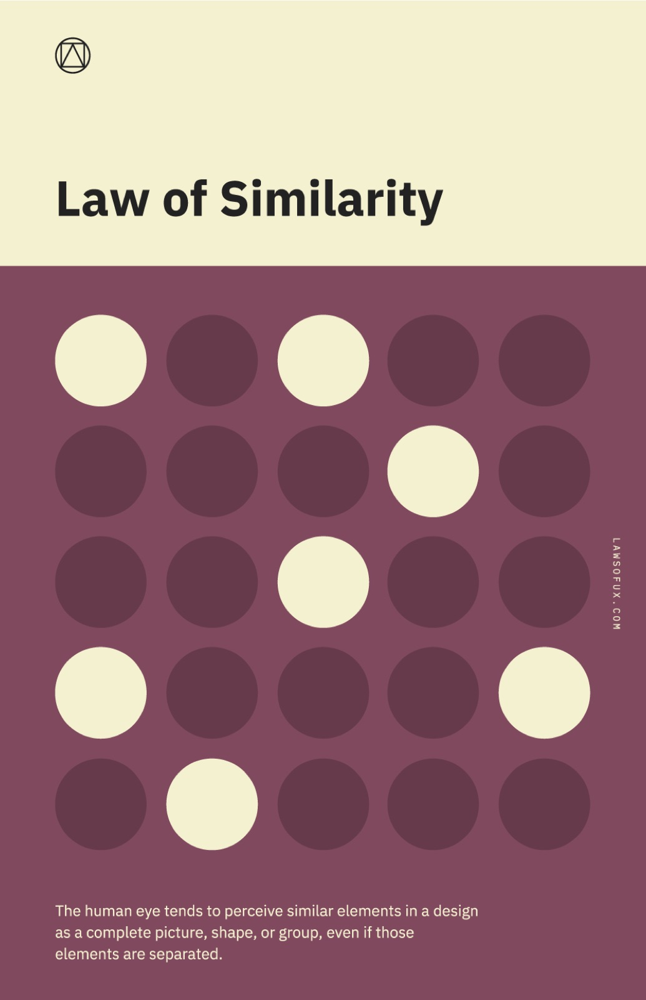

Below, we instantly recognise a dog walking, but of course, there is no dog. We made the dog because our brains filled in the blanks. When it comes to your designs, you must frequently be aware of why shapes, colours and contrast impact the emotions and even the thoughts of the user and try your best to categorise and correlate relevant subjects within some type of proximity.

---

## Law of Prägnanz

Keep it simple. Consider the Law of Prägnanz particularly when choosing your iconography and digital assets. 

---

## Miller's Law

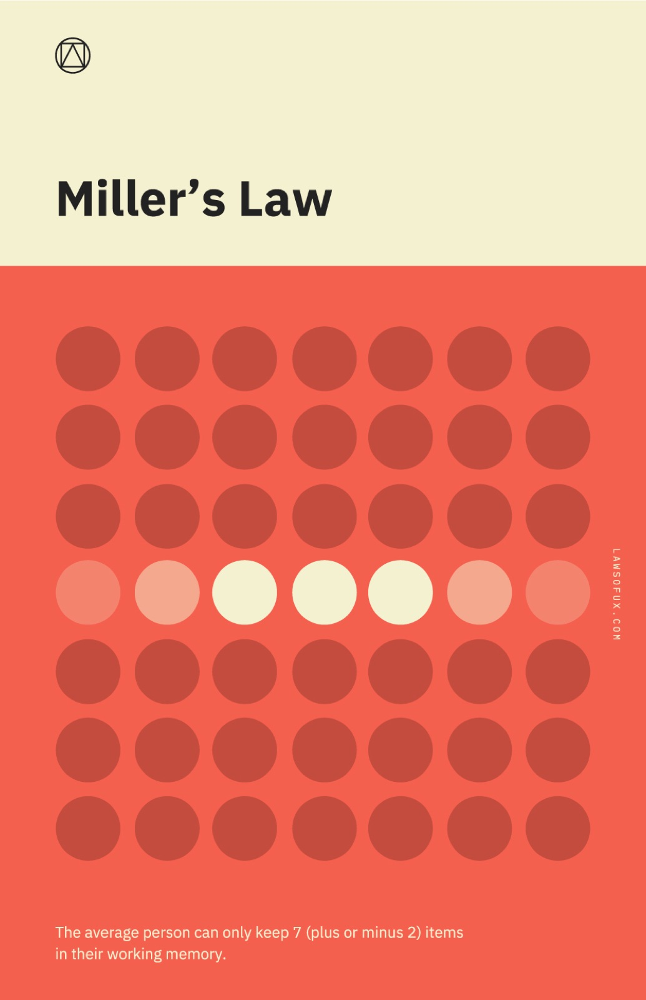

Frequently break up information into sizeable bite sized chunks. Do not make the user think. Lighten the cognitive load

---

## Pareto Principle

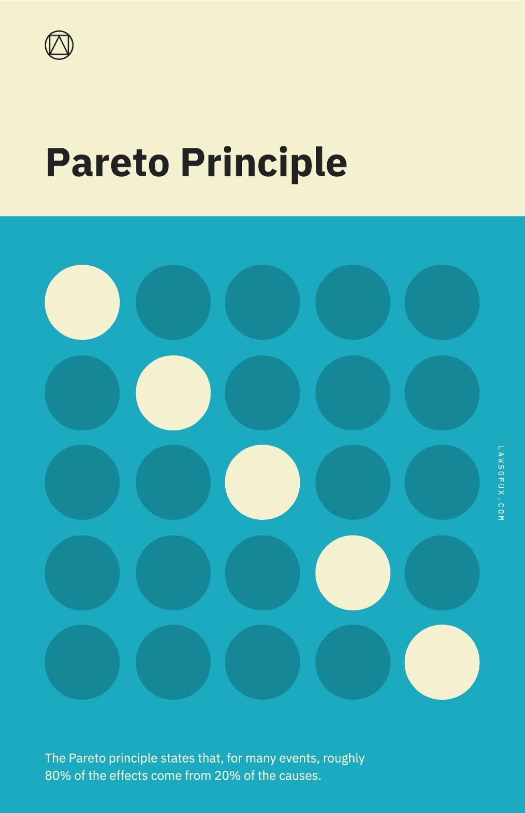

Focus on the 20% of design elements (buttons, menus, links) that contribute to 80% of user interactions. Ensure these elements are prominently placed, easily accessible, and intuitive to use equally identify the 20% of pages or features that attract 80% of user traffic or engagement. Focus on optimizing these high-traffic areas to improve overall user satisfaction.

---

## Peak-End Rule

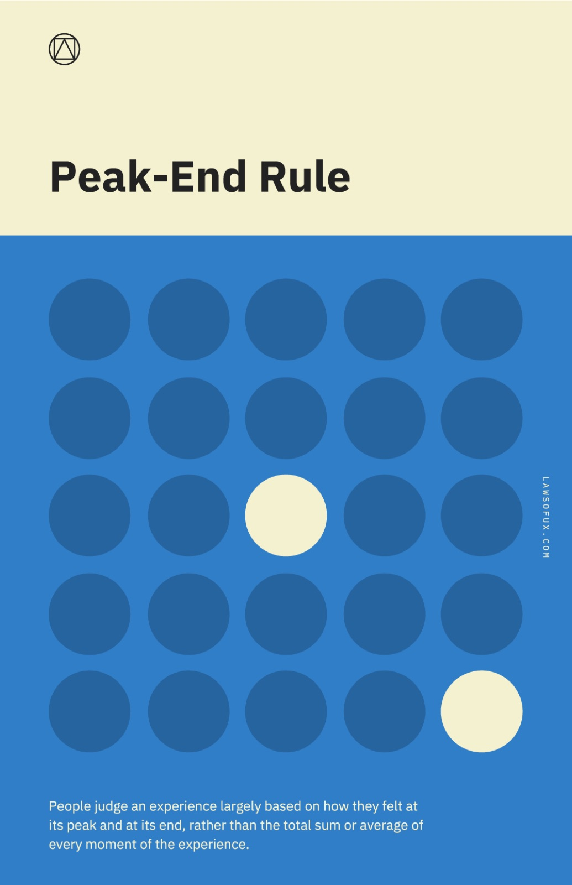

This rule reminds us of the importance in identifying the most valuable point in the user journey and making sure this part is particularly delightful. 

---

## Serial Position Effect

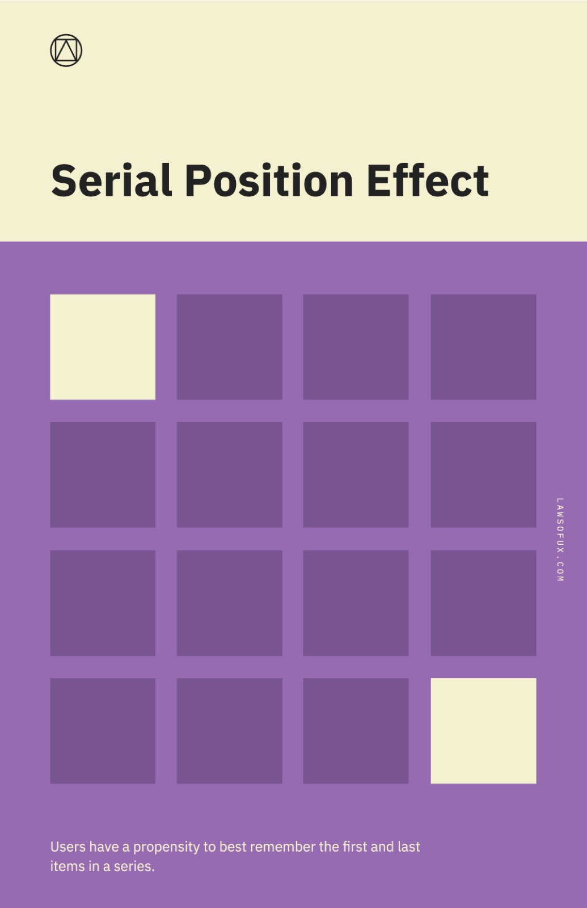

Onboarding, Landing and exiting is of paramount importance to your task flow. Pay specific attention to these parts of your work. 

---

## Tesler's Law

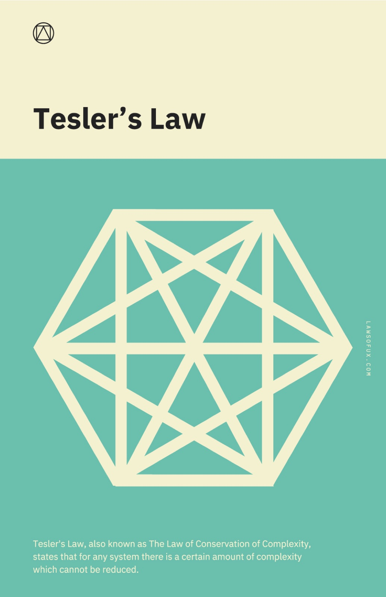

Tesler’s law will frequently come into play when we accept that there are a certain number of complexities which will be encountered. What we should always aim to do is remove all auxiliary and peripheral issues to arrive at the minimal complexity. The MVP. 

---

## Von Restorff Effect

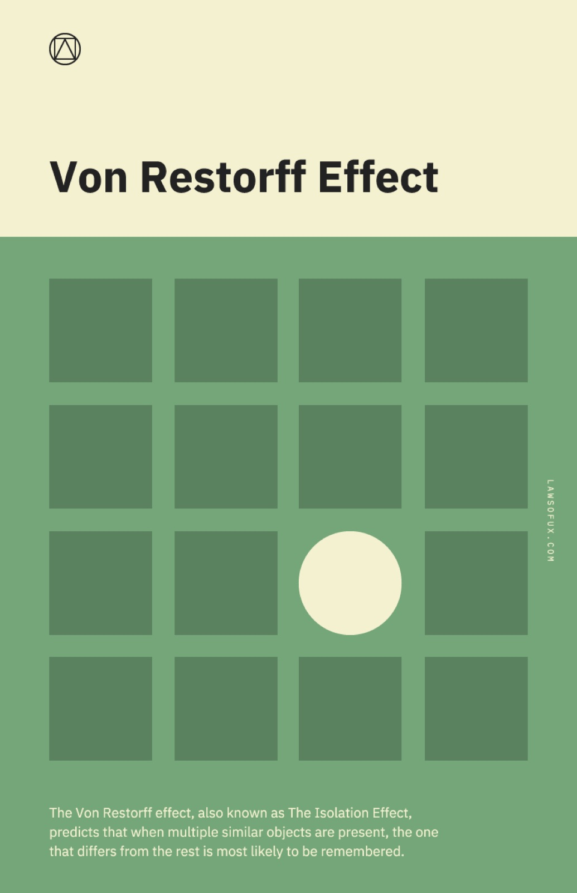

Look at these UI below. What stands out to you? 

---

## Zeigarnik Effect

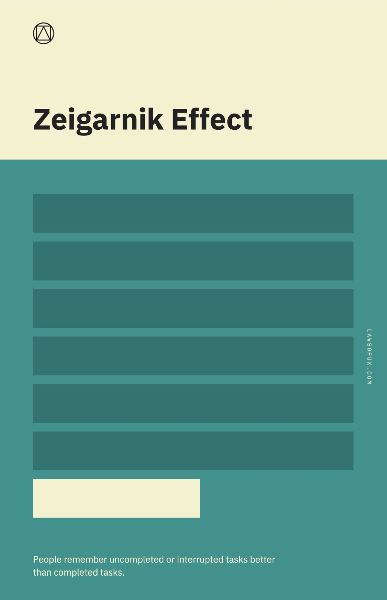

Finish on a half note. The above shape is frequently found in most UI designs. 

The laws of UX go beyond the examples presented here and I encourage you to explore the various ways that human perception impacts the ways in which UI is created. We should rigidly adhere to these principles because being aware of perception is vital when we are dealing with design which is within itself something which is sensory and based on the interactions between the human and the computer.   

---

## Why it matters for UX

The Laws of UX turn decades of psychology research into rules you can apply on every screen. They help you justify design decisions to your team with evidence instead of taste, and they catch problems such as too many choices or a forgettable ending before users do.

## Try it: apply three laws (30 minutes)

1. Open the checkout or sign-up flow of an app you use.
2. Count the choices on each screen (Hick's Law) and measure how far your thumb travels to the main button (Fitts's Law).
3. Find what stands out on each screen (Von Restorff Effect). Is it the most important thing?
4. Write three recommendations, each naming the law it is based on.

## Media

[https://www.youtube.com/watch?v=pbbTOzArcWQ](https://www.youtube.com/watch?v=pbbTOzArcWQ)

[https://www.youtube.com/watch?v=M-9FbUJk6tI](https://www.youtube.com/watch?v=M-9FbUJk6tI)

## Resources

[Laws of UX – Jon Yablonski](https://lawsofux.com/)

[Fitts's Law and Its Applications in UX – Nielsen Norman Group](https://www.nngroup.com/articles/fitts-law/)

[The Peak–End Rule – Nielsen Norman Group](https://www.nngroup.com/articles/peak-end-rule/)

## Key takeaways

- The Laws of UX are psychology principles you can apply directly to interfaces.
- Fewer choices, familiar patterns and chunked information lower cognitive load.
- Use the laws to explain design decisions with evidence, not taste.
