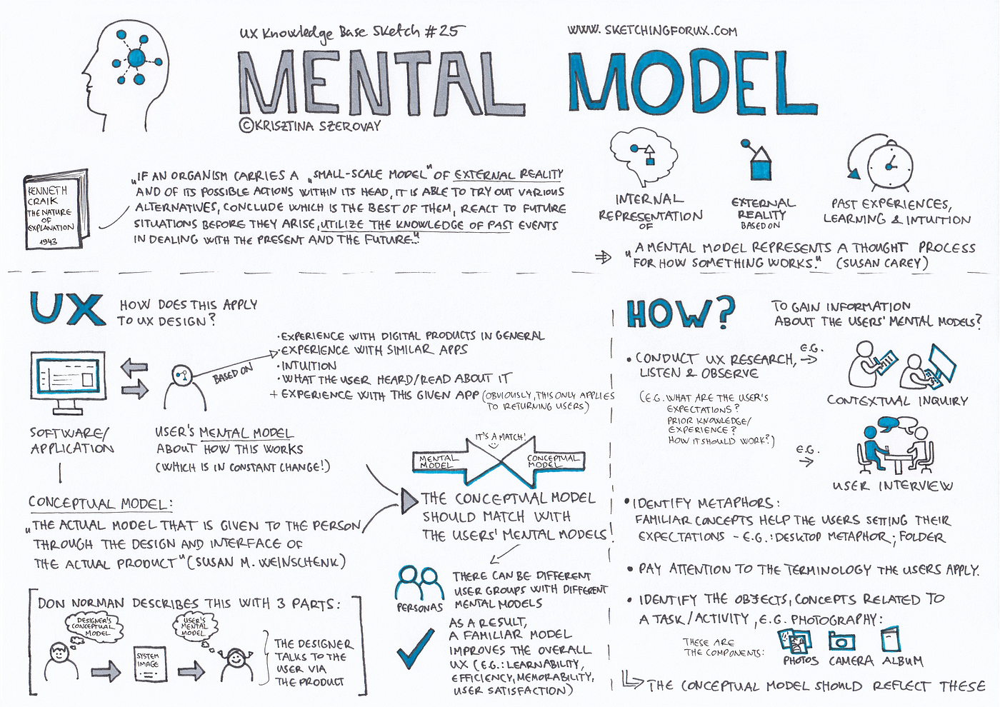

# Mental Models

### Key Features of Mental Models:

1. **Simplification of Reality**: Mental models help us simplify complex systems or situations. They provide a framework for understanding how things work.
2. **Influence on Thinking and Behavior**: These models shape how we perceive information, make decisions, and act. They can guide our behavior by providing shortcuts for understanding new situations.
3. **Based on Experience and Knowledge**: Our mental models are shaped by our past experiences, education, culture, and personal observations. They are unique to each individual but can be shared within groups.
4. **Dynamic and Evolving**: As we gain new information and experiences, our mental models can change. They are not static and can be updated as we learn.

---

### Bias in Mental Models:

**Biases are Flawed Mental Models**: Biases often arise when mental models are incomplete, outdated, or overly simplistic. For example, if someone has a mental model that equates leadership with masculinity, they may have a bias against seeing women as effective leaders.

**Confirmation Bias as a Mental Model Issue**: One of the most common biases, confirmation bias, occurs when people favor information that confirms their existing beliefs or mental models and disregard information that contradicts them. This bias is directly tied to how mental models filter information.

---

### Recognition rather than Recall and Jakob's Law

**Leveraging Existing Mental Models**: When users recognize interface elements (like buttons, icons, and navigation menus), they rely on their existing mental models rather than needing to recall specific details. This recognition process is faster and requires less cognitive effort.

In most instances, the stored expectation will, to a certain extent, resemble the real-life model or prior UI experience. This is important because users will plan and predict future actions within a system based on their mental models. It's also why **consistency is so important in UI design**.

---

## Why it matters for UX

Users bring a model of how things work to every screen. When your design matches it, the product feels intuitive; when it doesn't, users make mistakes and blame themselves. Consistency with familiar patterns (Jakob's Law) is the cheapest usability win there is.

## Try it: spot the broken model (20 minutes)

1. Pick an app or website that confused you the first time you used it.
2. Write down what you expected to happen, and what actually happened.
3. Name the mental model you brought with you, and where it came from (another app, the physical world).
4. Sketch a change that would match the design to that model.

## Media

[https://www.youtube.com/watch?v=nAgXISssAws](https://www.youtube.com/watch?v=nAgXISssAws)

## Resources

[Mental Models and User Experience Design – Nielsen Norman Group](https://www.nngroup.com/articles/mental-models/)

[What are Mental Models? – Interaction Design Foundation](https://www.interaction-design.org/literature/topics/mental-models)

## Key takeaways

- A mental model is what users believe about how a system works, based on past experience.
- Biases are flawed mental models; confirmation bias filters what we notice.
- Design for recognition rather than recall, and stay consistent with patterns users already know.
