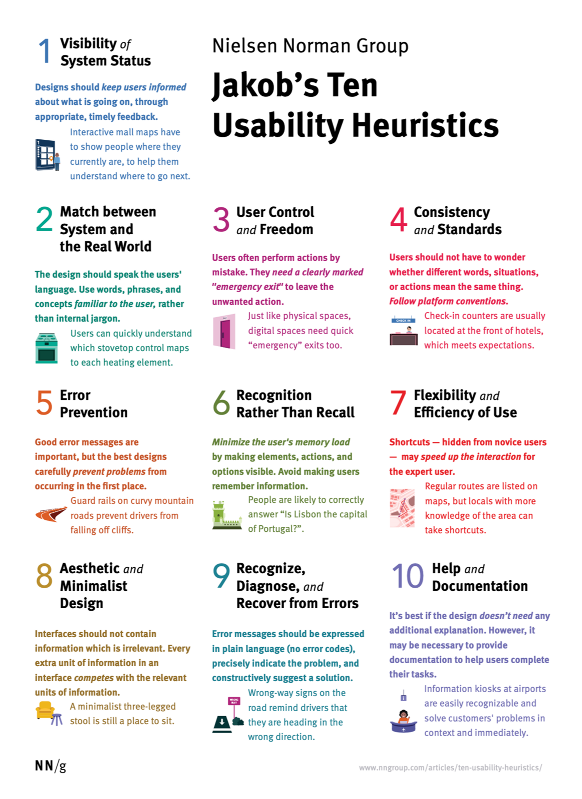

# Nielsen Heuristics

Dr Jakob Nielsen (above, left, with Don Norman) is the co-founder of Nielsen Norman Group. In 1994 he published his **10 usability heuristics**: broad rules of thumb for interface design, refined from his earlier work with Rolf Molich. They are called *heuristics* because they are not strict rules, but they have held up for three decades, from desktop software to phones, watches and AI chat interfaces.

It is of paramount importance that we learn and apply these rules, and combine them with the design-thinking phases, to produce a product that can actually be used in the way the customer wants to use it. In essence, this is achieved by knowing users' behaviours and responding appropriately to them.

## How to use them

- **While designing:** run through the list before you hand over a screen.
- **To review a design:** a *heuristic evaluation* is when a few reviewers go through an interface heuristic by heuristic and list every problem they find, with how severe it is.
- **Alongside testing, not instead of it:** heuristics catch common problems cheaply, but only real users show you how people actually behave.

---

## 1. Visibility of system status

The design should always keep users informed about what is going on, through appropriate feedback within a reasonable amount of time.

- **Example:** a progress bar while a file uploads; "Order received, ready in about 8 minutes"; a tick when a form saves.
- **Ask yourself:** after every action, does the user know it worked, and what is happening now?

[https://www.youtube.com/watch?v=cTtc90jCULU](https://www.youtube.com/watch?v=cTtc90jCULU)

## 2. Match between the system and the real world

Speak the users' language. Use words, phrases and concepts familiar to them rather than internal jargon, and follow real-world conventions so that information appears in a natural, logical order.

- **Example:** a shopping "basket"; a calendar that looks like a calendar; "Delivery address" rather than "Shipping endpoint".
- **Ask yourself:** would my users understand every label without explanation?

[https://www.youtube.com/watch?v=0TAt9Pln51g](https://www.youtube.com/watch?v=0TAt9Pln51g)

## 3. User control and freedom

Users often perform actions by mistake. They need a clearly marked "emergency exit" to leave an unwanted action without going through an extended process.

- **Example:** Undo after archiving an email; a clear Cancel or Back button; closing a pop-up with an X.
- **Ask yourself:** can people back out of anything, easily, at any point?

[https://www.youtube.com/watch?v=MXuk-fdbr0A](https://www.youtube.com/watch?v=MXuk-fdbr0A)

## 4. Consistency and standards

Users should not have to wonder whether different words, situations or actions mean the same thing. Follow platform and industry conventions, and be consistent within your own product.

- **Example:** the logo in the top left goes home; the same button style for every primary action; a magnifying glass for search.
- **Ask yourself:** does this behave the way the rest of my product, and the rest of the web, has taught people to expect?

[https://www.youtube.com/watch?v=Ibndy9KLOSQ](https://www.youtube.com/watch?v=Ibndy9KLOSQ)

## 5. Error prevention

Good error messages are important, but the best designs prevent problems from happening in the first place: remove error-prone conditions, or ask users to confirm before they commit to an action.

- **Example:** a date picker instead of free text; greying out unavailable dates; "Delete 240 photos?" before deleting.
- **Ask yourself:** where could someone slip up here, and can the design make that mistake impossible?

[https://www.youtube.com/watch?v=imS9s1DUY-I](https://www.youtube.com/watch?v=imS9s1DUY-I)

## 6. Recognition rather than recall

Minimise the user's memory load by making elements, actions and options visible. People should not have to remember information from one part of the interface to another.

- **Example:** recently viewed items; search suggestions; showing the delivery address on the payment step.
- **Ask yourself:** am I asking people to remember something I could simply show them?

[https://www.youtube.com/watch?v=6glQPp6q4Jc](https://www.youtube.com/watch?v=6glQPp6q4Jc)

## 7. Flexibility and efficiency of use

Shortcuts, hidden from novice users, can speed up interaction for experts, so the design caters to both inexperienced and experienced users. Let people tailor frequent actions.

- **Example:** keyboard shortcuts; "Reorder" in a food app; saved payment details; swipe actions in a mail app.
- **Ask yourself:** is there a faster path for people who do this every day, without getting in the way of first-timers?

[https://www.youtube.com/watch?v=LoTdRTBB8BQ](https://www.youtube.com/watch?v=LoTdRTBB8BQ)

## 8. Aesthetic and minimalist design

Interfaces should not contain information that is irrelevant or rarely needed. Every extra unit of information competes with the relevant units and reduces their visibility.

- **Example:** one clear primary button per screen; showing the three key facts on a product card, with the rest one tap away.
- **Ask yourself:** what can I remove without losing anything people need right now?

[https://www.youtube.com/watch?v=ZgbRmeWDgd0](https://www.youtube.com/watch?v=ZgbRmeWDgd0)

## 9. Help users recognise, diagnose and recover from errors

Error messages should be expressed in plain language (no error codes), precisely indicate the problem, and constructively suggest a solution.

- **Example:** "That card has expired. Check the date or use another card," shown next to the field, instead of "Error 402".
- **Ask yourself:** does every error say what went wrong, where, and how to fix it?

[https://www.youtube.com/watch?v=cCun-ReLTFI](https://www.youtube.com/watch?v=cCun-ReLTFI)

## 10. Help and documentation

It's best if the system doesn't need any extra explanation. But it may be necessary to provide help, so make it easy to search, focused on the user's task, and listed as concrete steps.

- **Example:** a short tooltip next to a tricky field; an in-context "How does this work?" link; a searchable help centre.
- **Ask yourself:** when someone gets stuck, can they find a short, task-focused answer right where they are?

[https://www.youtube.com/watch?v=iIQVRzatb50](https://www.youtube.com/watch?v=iIQVRzatb50)

---

## Exercise: a quick heuristic evaluation (20 minutes)

1. Pick one app you use every day and one key task in it (for example, booking, paying or searching).
2. Go through the task screen by screen, checking it against all ten heuristics.
3. For each problem, write: the screen, the heuristic it breaks, and how severe it is (cosmetic, minor, major or critical).
4. Pick the two most severe problems and sketch a fix for each.

## Resources

[10 Usability Heuristics for User Interface Design – Nielsen Norman Group](https://www.nngroup.com/articles/ten-usability-heuristics/)

[How to Conduct a Heuristic Evaluation – Nielsen Norman Group](https://www.nngroup.com/articles/how-to-conduct-a-heuristic-evaluation/)

## Summary

The 10 usability heuristics are the quickest checklist in UX: keep people informed, speak their language, let them back out, be consistent, prevent errors, show rather than make them remember, offer shortcuts, cut the clutter, write helpful errors and provide help where it's needed. Use them while you design and when you review, then test with real users.
