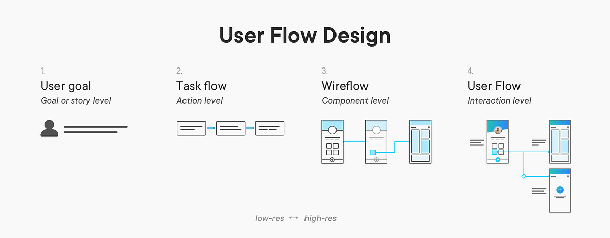
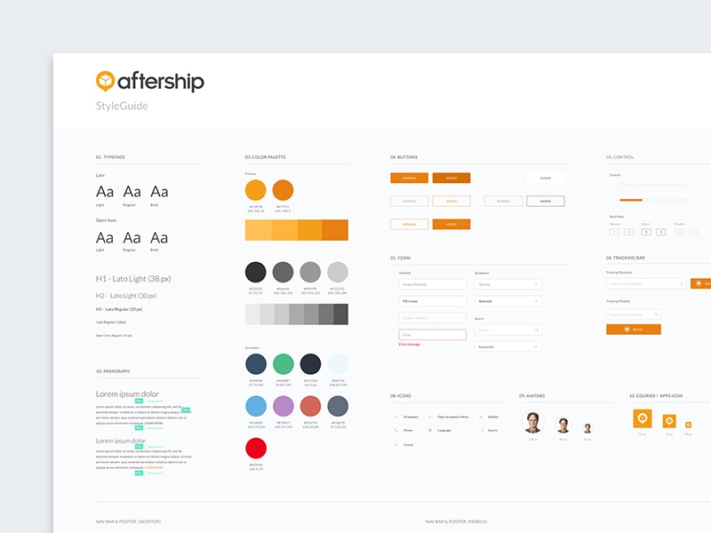

title: Stages of Wireframes
promise: From task flow to prototype: how fidelity rises step by step, so you fix the logic while changes are still cheap.
duration: 15 minutes
topics:
- What fidelity means
- Task flow and sketching
- Paper wireframes (lo-fi)
- Mid-fi wireframes in Figma
- Style guide and hi-fi wireframes
- The prototype
---
@title
# Stages of Wireframes
From rough logic to a finished prototype, one step up at a time.
---
@statement
**Fidelity** means faithfulness to the final design.

The closer you are to the final look, the higher the fidelity.
---
@cards
## Seven steps

- **Task flow** The raw logic
- **Sketching** Explore ideas, for yourself
- **Paper wireframes** Lo-fi screens you can test
- **Mid-fi wireframes** Greyscale, in Figma
- **Style guide** The visual rules
- **Hi-fi wireframes** As close to final as it gets
- **Prototype** Hi-fi plus interaction
---
@image
## Task flow

*An ordered sequence of actions a user takes to complete one task. Part of information architecture, and the lowest fidelity you can work at.*
---
@split
## Sketching

A quick, **optional** stage to explore different solutions.

Sketches are usually just for you: a starter for your own thinking.
---
@split
## Paper wireframes

**Low fidelity.** Boxes and lines for the layout and flow of each screen.

Fast to make, cheap to throw away and easy to test as a paper prototype.

This is where you **get the logic right**.
---
@split
## Mid-fi wireframes

Your paper screens in **Figma**: real elements and real copy on a grid, at the right size.

**Greyscale**, so everyone discusses function and layout, not colour.

Build with components and Auto Layout from the start.
---
@split
## Style guide

The visual standards: **type, colour, logos, imagery, icons and spacing**.

Create it before hi-fi, as Figma styles and variables, then apply it without touching the logic.
---
@image
## Hi-fi wireframes

*The style guide applied, real content in place, every state designed. About 95% faithful to the final product.*
---
@image
## Prototype

*Hi-fi wireframes plus interaction design: touch points, transitions and flows you can test with users.*
---
@statement
Every step up in fidelity costs more time, and makes people **less willing to change** what they see.

Prove the flow first. Polish last.
---
@text
## You don't always need every step

Look at how much has already been done, and how much time you have.

Then choose where to **start** and where to **finish**.
---
@exercise
## Which stage?

1. Deciding whether sign-up comes before or after browsing
2. Choosing the colour of the primary button
3. Testing the checkout with a user tomorrow morning, with no laptop
4. Checking the real copy fits a 393 px screen, before any colour
5. Showing the client how screens slide from one to the next
6. Presenting near-final screens with real photos
---
@answers
## Check yourself

1. **Task flow:** it's pure logic
2. **Style guide:** a visual rule for every button
3. **Paper wireframes:** a paper prototype is all you need
4. **Mid-fi wireframes:** real elements and copy, in greyscale
5. **Prototype:** hi-fi plus interaction
6. **Hi-fi wireframes**
