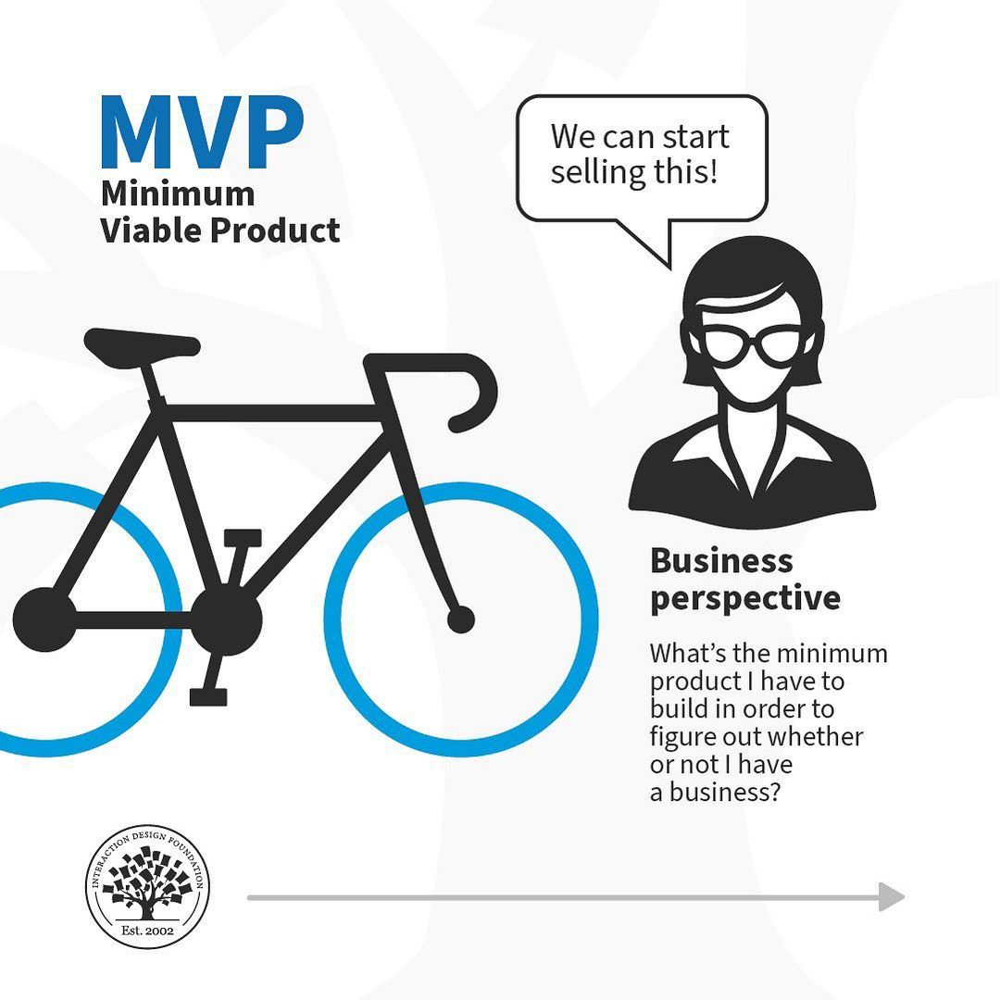
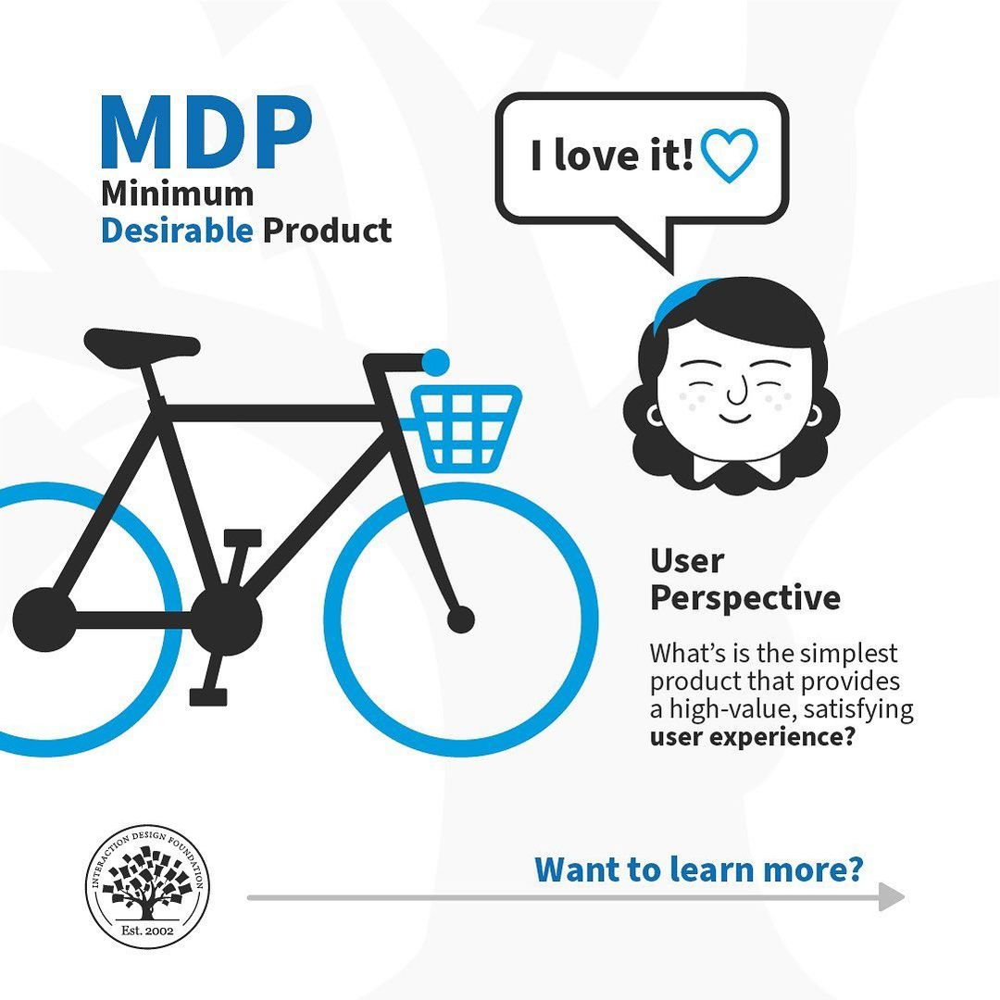
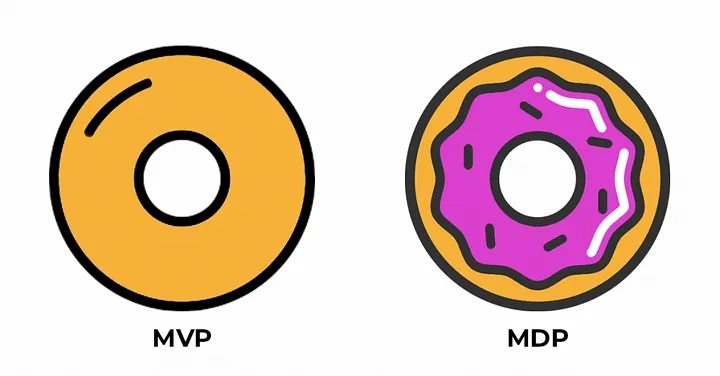

# Target MVP

## Minimum Viable Product

The establishment of the **Minimum Viable Product** is crucial for adding definition to your decision making and represents the core concept that you want to create. It is the conduit or vehicle for you to reach your research goal and represents the leanest possible version of a product that you could release to market that would effectively help to answer the questions behind your research. Ultimately, the Minimum Viable Product represents the primary functionalities without much embellishment or bonus features. It contains the essential ingredients only. 

---

## Most Valuable Person

The **Most Valuable Person** references the user segment and persona that brings the most value to the business, service or product. For all intents and purposes it is the group that brings the most reward and promise and essentially targeting this group should answer the ultimate question of who is this product for. Who is the focused group that you believe should be aimed at.

---

## Minimum Desirable Product

The **Minimum Desirable Product** represents the concept of establishing a suite of features that step beyond the core functionality and demonstrates an idea that provides exceptionally high value. It is not simply concerned with core functionality alone but offers a more refined vision with added features and styles that could add maximum value to both the business and customer.  

---

## Why it matters for UX

Scope is where most projects fail. The MVP keeps you focused on the smallest thing that tests your idea, the Most Valuable Person keeps you focused on who it is for, and the Minimum Desirable Product reminds you that people have to want to use it, not just be able to.

## Try it: cut it down (20 minutes)

1. List every feature you could put in your current project.
2. Name your Most Valuable Person in one sentence.
3. Cross out every feature that person doesn't need on day one. What's left is your MVP.
4. Add back the one feature that would make them love it. That's your Minimum Desirable Product.

## Media

[https://www.youtube.com/watch?v=HjOdNmpGaTw](https://www.youtube.com/watch?v=HjOdNmpGaTw)

[https://www.youtube.com/watch?v=9Swz0LJAEdY](https://www.youtube.com/watch?v=9Swz0LJAEdY)

## Resources

[What are Minimum Viable Products (MVP)? – Interaction Design Foundation](https://www.interaction-design.org/literature/topics/minimum-viable-product)

[Minimum viable product – Wikipedia](https://en.wikipedia.org/wiki/Minimum_viable_product)

## Key takeaways

- The MVP is the leanest version of a product that answers your key questions.
- The Most Valuable Person is the user group that brings the most value; design for them first.
- The Minimum Desirable Product adds just enough delight that people want to use it.
