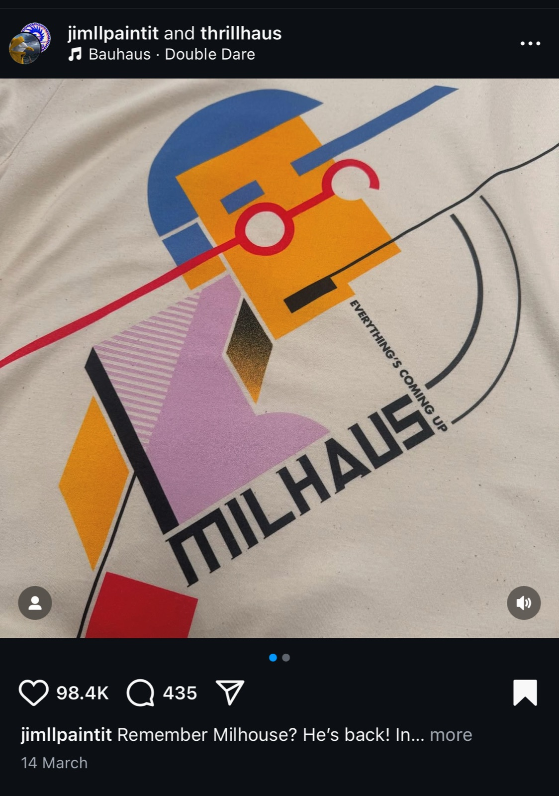
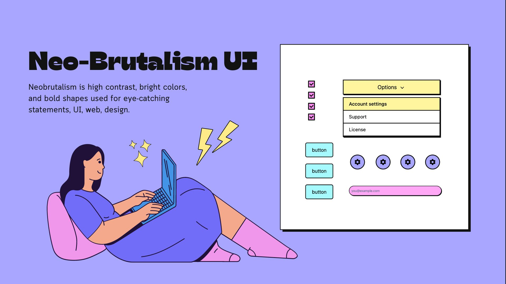
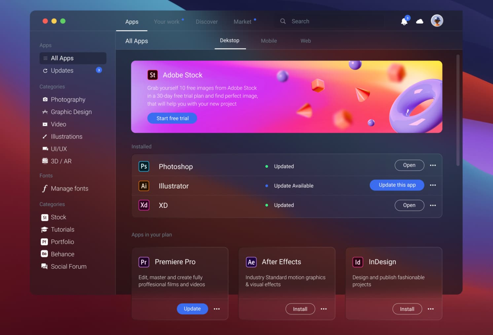
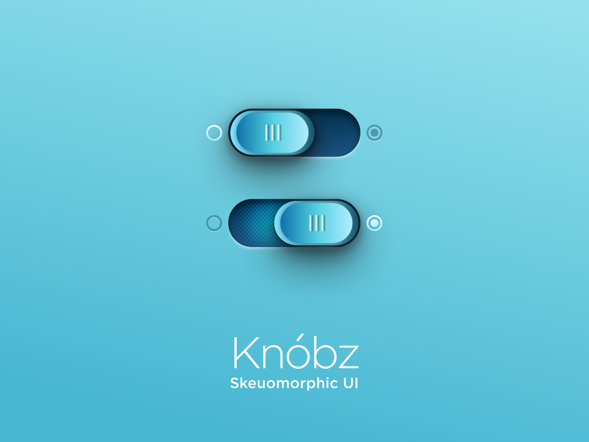
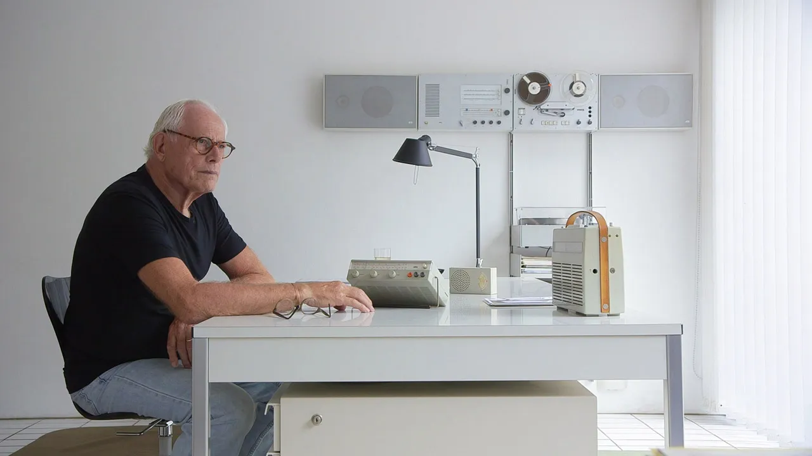

# The Bias of Beauty

> **Beauty of style and harmony and grace and good rhythm depend on simplicity**
> 

Plato

## Symmetry and Beauty in Nature

Beauty is synonymous with symmetry and symmetry is an extension of the physical world. Your work must achieve a cadence and consistency which gives the user a pattern they can predict. 

---

It’s important too that our work is beautiful in order that it it is **perceived** as good and beneficial.

## Beautiful People are Treated Better

It’s a fact that naturally beautiful people receive a range of social benefits that the rest of us don’t enjoy.

- **Employment**: Research has shown that attractive individuals tend to be more successful in job interviews and are more likely to be hired and promoted. Employers may unconsciously associate physical attractiveness with competence, intelligence, and social skills.
- **Wages**: Studies have found that attractive individuals often earn higher wages compared to their less attractive counterparts.

---

- Attractive people are generally perceived more positively and may receive better treatment in social situations.
- Some studies suggest that attractive individuals may receive more lenient treatment in legal proceedings, including

What this means is that your work must be attractive in order for it to be trusted and seen as credible. Aestheticism is so important that it forms a core heuristic.  

---

## The Beauty Heuristic (Heuristic 8)

Aesthetically pleasing designs can provide memorable experiences that differentiate a brand. However, interfaces should only include necessary elements, with high informational value. Clarity will always win over visual flourish.

> Have nothing in your houses that you do not know to be useful, or believe to be beautiful.
> 

William Morris

Interfaces should not contain information which is irrelevant or rarely needed. Every extra unit of information in an interface competes with the relevant units of information and diminishes their relative visibility.

---

## Balancing Form with Function

> Form follows function.
> 

Louis Sullivan

Is the famous maxim coined by architect Louis Sullivan (1856–1924), and through this idea he articulates the principle that the shape of a building or object should directly relate to its intended function or purpose. 

Whilst the aesthetic will earn you initial trust from the user, without substance they will quickly abandon your software. 

---

Balance is key. 

---

## Emotional Design

> **Design is not a product, it's a feeling.**
> 

Don Norman, Father of UX

---

## Emotion and Decision Making

Markets behave irrationally because most people make decisions emotionally. We’ll discuss further later but the reason why we must appeal to the user’s emotion is because we want them to feel strongly whilst using our service or product. Ultimately we want them to frequently engage with our service again and again and again. Whether it is in their interests or otherwise.

[https://xd.adobe.com/view/f1465d41-21f7-4b22-bbe3-f6e329d7156e-a415/?fullscreen](https://xd.adobe.com/view/f1465d41-21f7-4b22-bbe3-f6e329d7156e-a415/?fullscreen)

A good User Experience designer is getting people to the point where they don’t actually think or need to think. Because thinking is hard. But not thinking can have consequences. 

---

## Some Beautiful Design Waves

Bauhaus

---

German artistic movement preaching the gospel of functionalism, the principle that buildings should be designed based solely on their purpose and function. Bauhaus designs use geometric shapes and elegant layouts, but always keep the **focus on the elements**. 

---

> A picture is worth a thousand words.
> 

Fred R. Barnard

### Brutalism

An architectural movement that leaked its way into web design in 2010, characterised by the use of raw text, system fonts, underlined links, monochromatism and untreated raw photography.   

---

### Neobrutalism

An extension of Brutalism, characterised by its high contrast and vibrancy. Neo-Brutalist web design places a strong emphasis on content, with illustrations serving to highlight and showcase the information or message being conveyed. 

---

### Neumorphism

Otherwise referred to as soft UI, is a design trend that emerged in the early 2020s. Combines elements of skeuomorphism, flat design, and realism to create interfaces that appear soft, tactile, and three-dimensional. 

---

### Glassmorphism

Otherwise referred to as frosted glass UI, prevalent today, especially in VR, characterised by 
semi-transparent modular panels. 

---

### Skeuomorphism

Essentially the bedrock of many modern UI designs, skeuomorphism meets the criteria of a core heuristic that there should be a match between the system and the real world. 

Skeuomorphism retains ornamental design cues from structures that are necessary in the original. Skeuomorphs are typically used to make something new feel familiar in an effort to speed up understanding and user acclimatisation.

---

Critics of the skeuomorphic design approach preach that users don’t actually need matches between system and real world to understand digital spaces anymore because they understand those spaces just as easily now as they would a real world interaction. In other terms, the modern user has so completely acquired the language of the internet that there is no need to overtly match the system to the real world anymore. 

 The man that designed every Apple product without stepping foot in the building

---

> I hate everything that is driven by fashion. From the beginning it was hating the sixties American way of styling. Especially the cars. They changed their cars every two years to sell new ones. Which has nothing to do with good design.
> 

Dieter Rams

---

## Summary

Use aesthetics, beauty and art to create attractive layouts but do not under estimate the value of substance. Art is not necessarily design and design is not necessarily art. Good user experience design should be moral and not abuse users or eventually catastrophe will strike. We haven’t seen a mass exodus away from technology yet but if things are allowed to remain the same and if unethical design practises continue, eventually, everything will be lost. Balance between style and substance is key. 

 

> Appearances are often deceiving.
> 

Aesop

---

Disclaimer: Here is real beauty. 

---

## Why it matters for UX

Users judge beautiful interfaces as easier to use and more trustworthy, even when they aren't (the aesthetic-usability effect). That gives good visual design real power: it buys patience and trust. It also means beauty can hide usability problems, so test with users rather than trusting first impressions.

## Try it: beauty versus usability (25 minutes)

1. Find two apps that do the same job, one you find beautiful and one you find plain.
2. Complete the same task in both and time yourself.
3. Note where the beautiful one was harder to use than it looked, and where the plain one was easier.
4. Choose one of the design waves on this page and restyle one screen of the plain app in it, keeping every function.

## Media

[https://www.youtube.com/watch?v=NG7MINxqVE0](https://www.youtube.com/watch?v=NG7MINxqVE0)

## Resources

[The Aesthetic-Usability Effect – Nielsen Norman Group](https://www.nngroup.com/articles/aesthetic-usability-effect/)

[10 Usability Heuristics for User Interface Design – Nielsen Norman Group](https://www.nngroup.com/articles/ten-usability-heuristics/)

## Key takeaways

- People perceive beautiful designs as more usable and more trustworthy.
- Beauty buys patience, but it can also hide usability problems; test, don't assume.
- Design styles come and go; form should always serve function.
