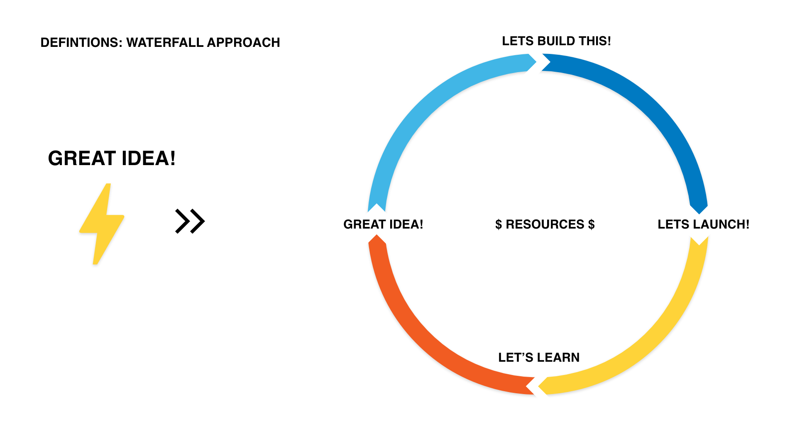
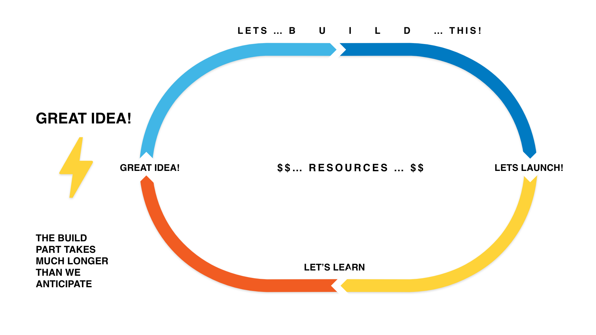
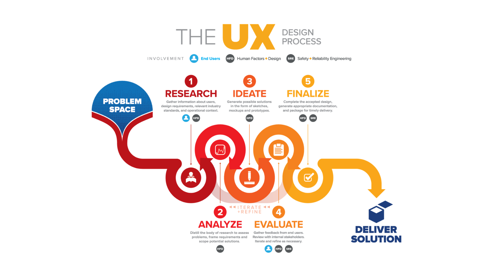
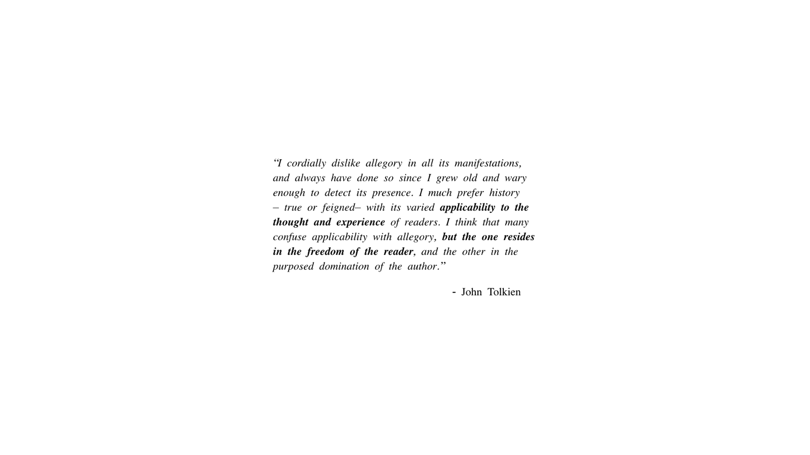
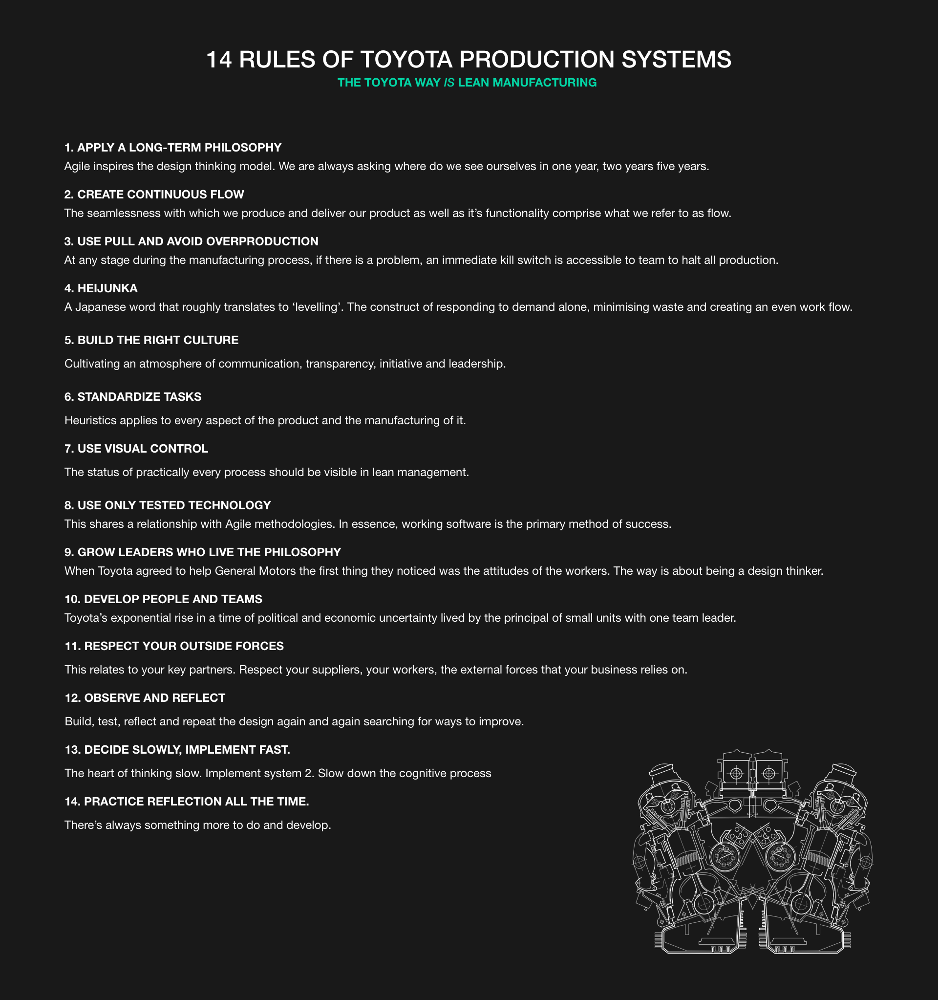

# The Death of Kodak

So let’s just take a minute to understand why we apply rapid prototyping to software design and we should adopt a design thinking mindset. 

Around the time of the advent of the internet in 1984, corporations throughout the business world were highly specialised into specific industry sectors and as a direct result, because of their hyper-specialisation, they were incapable of adapting to the changes brought about by the rise of the internet. 

## From $30 billion to bankruptcy

With the specific example of Kodak, in 1991 they enjoyed a market value of about $30 billion but by 2012, they filed for bankruptcy. Their value today floats around $400 million.

---

## Adapt or disappear

Tectonic plates shifted under the feet of other industry giants like major telecommunications companies who saw the rise of online messaging platforms like Facebook, Whatsapp and Instagram. Video rental stores, travel agencies, music, bookstores and even banks witnessed permanent change if not total annihilation. 

---

What equally became apparent was that working with the internet required a rapid response to the ever changing ways consumers were engaging with markets. If companies wanted to survive, they would have to ditch the overpowered mindset of managing value and less regard for creativity which was so widely practised throughout the 1980’s to early 90’s.  

A workflow of adaptation over specialisation was required to respond to shifting trends in consumer behaviour and market disruption and thus agile methodologies like Design thinking were born. 

---

---

---

---

---

## What design thinking asks of you

And it's also about Critical Thinking over Assumptions and 'Experience'. 

It’s about form and function. 

It’s still beautiful but not decadent. 

And we have some great rules. 

---

## Why it matters for UX

Kodak invented the digital camera and still went bankrupt, because it protected its old business instead of following its customers. It's the classic reason companies adopt design thinking: test fast, listen to users and be ready to change direction before the market does it for you.

## Try it: spot the next Kodak (20 minutes)

1. Pick an industry you know: banking, taxis, newspapers, travel or another.
2. List what customers used to do, and what they do now.
3. Find one company that adapted and one that didn't, and write what each did differently.
4. Write one question a design thinking team should be asking in that industry today.

## Media

[https://www.youtube.com/watch?v=u7yo7e3HhKA](https://www.youtube.com/watch?v=u7yo7e3HhKA)

## Resources

[Kodak's Downfall Wasn't About Technology – Harvard Business Review](https://hbr.org/2016/07/kodaks-downfall-wasnt-about-technology)

[Kodak – Wikipedia](https://en.wikipedia.org/wiki/Kodak)

## Key takeaways

- Kodak went from about $30 billion in 1991 to bankruptcy in 2012.
- Specialisation without adaptation is fatal when markets shift.
- Design thinking replaces assumption with rapid testing and critical thinking.
