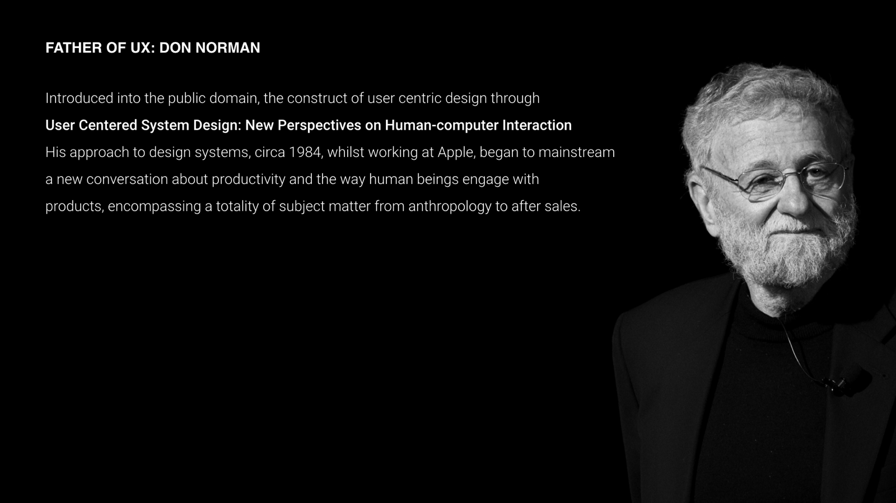
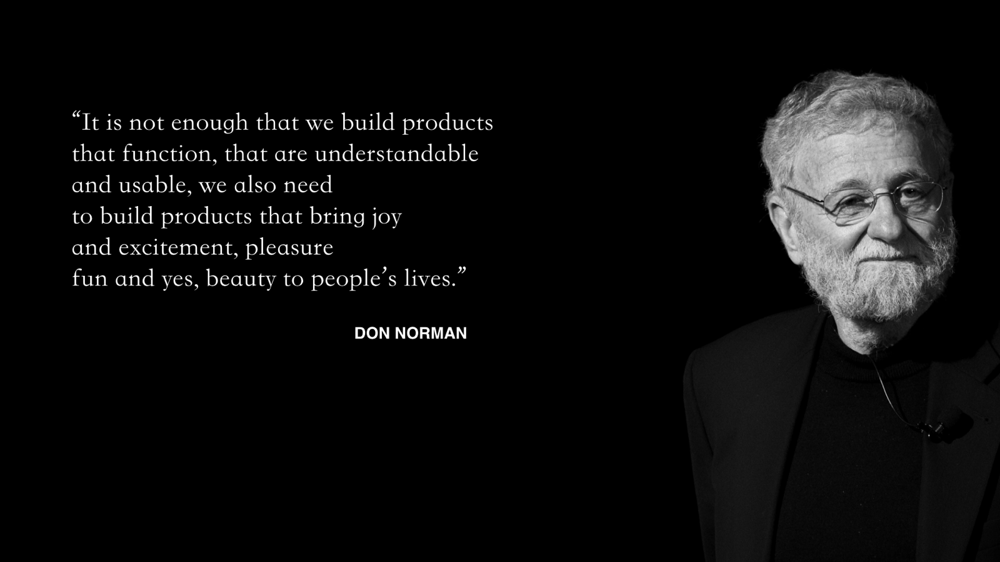

# The Father of UX

---

---

Don Norman believes that good UX consists of

## Four core principles

- **Affordance:** Otherwise referred to as utility, affordance refers to what **an object does**. What does it actually do. What is it’s core function. What does it afford. A chair affords the sitter, a car affords the driver. A ring affords a finger. It is key purpose or objective of the object. In order to create a good user experience, it is the case that the affordance of an object shouldn’t require too much thinking or cognitive strain.

 

- **Signifiers:** Communicate where the action should take place. Signifiers (Norman's word for signs) should be very clear indicators which allow the user to understand how to progress through the journey of the motion to complete an objective.

---

- **Mapping:** the spatial correspondence between a control and its results, like a cooker whose knobs are laid out in the same pattern as its rings. Mapping is essentially the way in which an application pivots around its parts. It’s not necessarily associated with signposts but rather the way in which a user explores the parameters of the software.

---

- **Feedback:** A core heuristic that fulfils the maxim, an informed user is a happy user, **f**eedback is that which communicates the result of an action. It is the heartland of human computer interaction and essentially establishes the discourse and dialogue between the user and the computer. It’s the feedback, the interplay and it’s the way in which the user established whether their goals have been achieved.

---

[https://xd.adobe.com/embed/bb647d52-f133-4f89-906e-6a6269813fd8-ee37/?fullscreen](https://xd.adobe.com/embed/bb647d52-f133-4f89-906e-6a6269813fd8-ee37/?fullscreen)

Because UI interfaces are so inherently similar it’s often the case that what they actually do, is not clearly understood. We must watch out for it and make sure that the function is always precise and clear.

---

> **The number one problem for UI in my experience is nearly always a lack of utility. You must always make it clear: what does your product actually do? What does it afford?**

Not only what an application does is of primal importance but how the action is completed, where the action takes place, how the users orientate themselves and what happens after the action is completed, are all deeply connected to the discipline / rules of User Experience design. 

---

## Emotional design

> **Design is not a product, it's a feeling.**
> 

Don Norman, Father of UX

Disclaimer: Regular consumption of soft drinks is associated with higher mortality and an increased risk of circulatory and digestive disease related deaths. How do you feel about the advert above?

> Good design is honest.
> 

Dieter Rams

---

## Why it matters for UX

Norman's principles are the vocabulary of interaction design. When a button doesn't look pressable, a control does the opposite of what you expect, or nothing tells you an action worked, it's because one of these principles was broken. Name the principle and you can fix the problem.

## Try it: an everyday-things audit (20 minutes)

1. Find three objects around you that annoy you: a door, a tap, a remote, a website.
2. For each, name which principle fails: affordance, signifier, mapping or feedback.
3. Sketch a fix for each.
4. Now do the same for one screen of an app you use every day.

## Media

[https://www.youtube.com/watch?v=_Kc57XAE_V4](https://www.youtube.com/watch?v=_Kc57XAE_V4)

[https://www.youtube.com/watch?v=rmM0kRf8Dbk](https://www.youtube.com/watch?v=rmM0kRf8Dbk)

## Resources

[What are Affordances? – Interaction Design Foundation](https://www.interaction-design.org/literature/topics/affordances)

[What are Signifiers? – Interaction Design Foundation](https://www.interaction-design.org/literature/topics/signifiers)

[Don Norman's website – jnd.org](https://jnd.org/)

## Key takeaways

- Affordance is what an object lets you do; signifiers show where and how.
- Mapping links controls to their results; feedback tells users what happened.
- Design is a feeling as well as a function, and good design is honest.
