# Typography

> Definition: **Typography** is the art and technique of arranging type to make written language legible, readable and appealing when displayed. The arrangement of type involves selecting typefaces, point sizes, line lengths, line-spacing, and letter-spacing, as well as adjusting the space between pairs of letters.
> 

> Definition: **Typeface** is the design of lettering that can include variations in size, weight (e.g. bold), slope (e.g. italic), width (e.g. condensed), and so on. Each of these variations of the typeface is a font.
> 

## Glyphs

Before typography and typefaces were invented people already were making attempts to create some printing techniques. The earliest versions are going all the way back to the second century BC. In Mesopotamia, Babylon, Crete Ancient Greece they used punches and dies to stamp letterforms or glyphs onto seals.

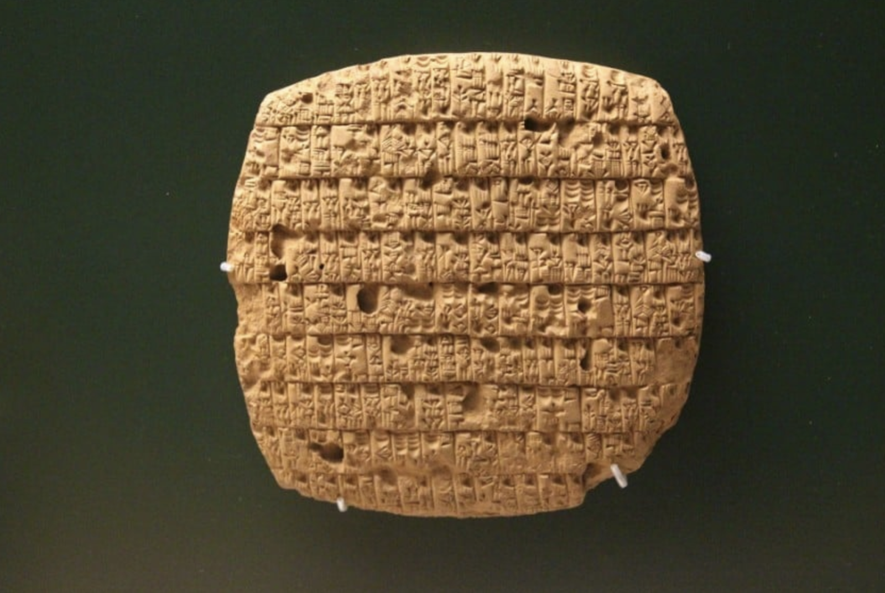

## Blackletter

But until the invention of the printing press all books were created by hand. Closer to the late Middle Ages in Europe hand-lettering evolved into complicated and beautiful art form mostly practiced by monks, books were not a mass product by any means but rather were luxury and art. The dominant style is known as blackletter, a Gothic calligraphy script. 

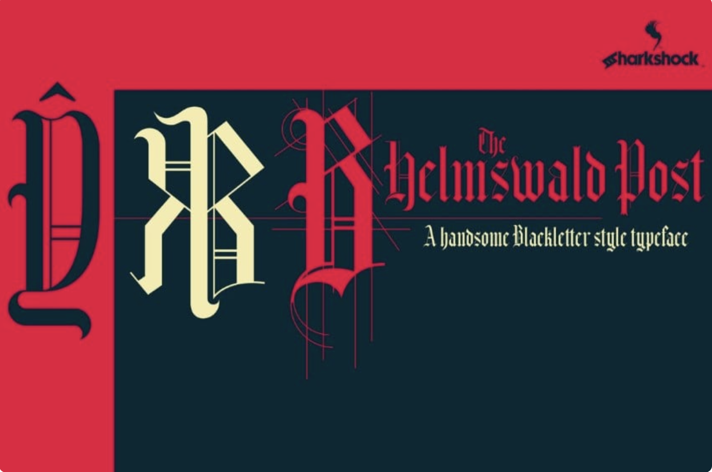

With the invention of the printing press by Johannes Gutenberg in the 15th century the first typeface was made and the first book was printed — a Bible. Of course this font was mimicking the hand-written blackletter. 

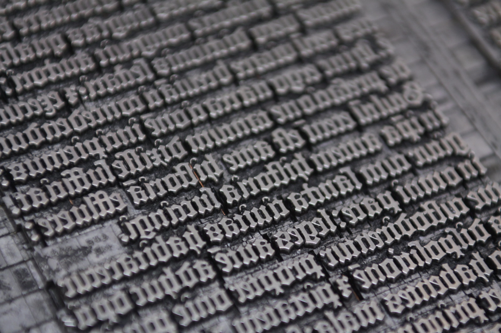

Reconstructed Gutenberg press, placed at the Department of Typography and Graphic Communication at the University of Reading, UK. Photo by [**Ben Mitchell**](https://www.flickr.com/photos/ohbendy/with/5942489307/)

## Roman

The blackness and ornateness of Blackletter made this typeface very hard to read so naturally quite soon (same 15th and 16th centuries) a new style of typeface became popular – **Roman**.

One of the earliest design belongs to Nicolas Jenson, which got inspiration from ancient roman type styles. Typeface named **Jenson** is an example of one of the **Old Style** typefaces, which are defined by low contrast between thick and thin strokes.

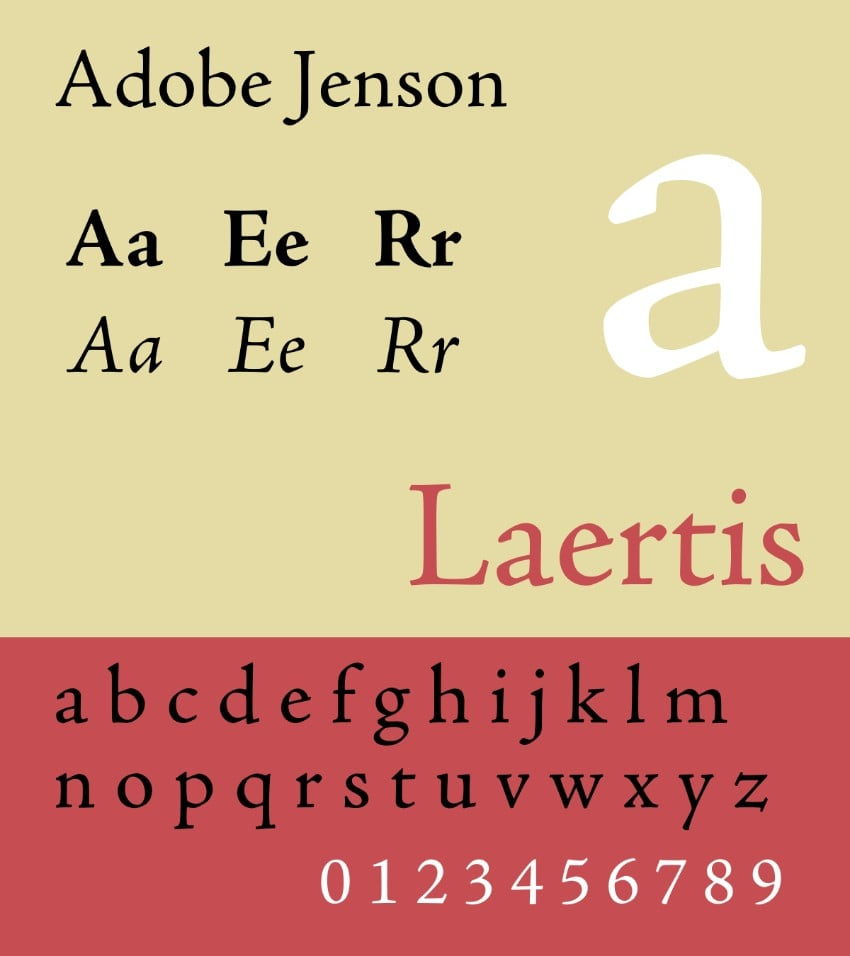

## Modern Serifs

Roman typefaces remained popular for until 18th century when serif typeface got more modern design and shape as we know it today.

There are several designers traditionally mentioned in regard of this style, called **humanist serifs**. 

William Caslon who in London created a refined and much more elegant version of the Jensen’s Old Style serifs and named it **Caslon.**

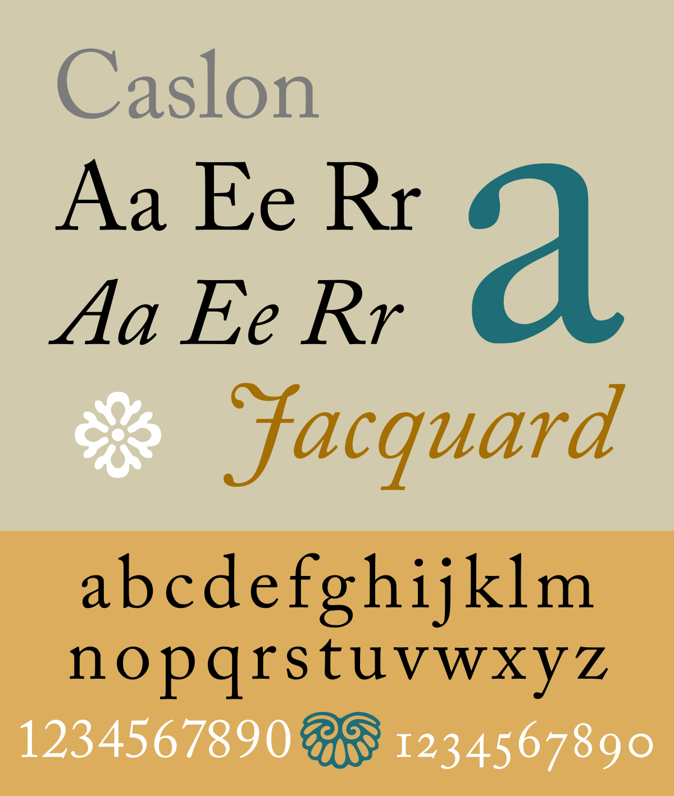

A couple of decades later, in the 1750s the first **Transitional** typeface was designed by John Baskerville. Named **Baskerville**, it has thinner serifs and higher contrast between thick and thin strokes compared to Old Serif and has more formal appearance compared to Caslon. This typeface is still one of the most popular among the book typesetters even now.

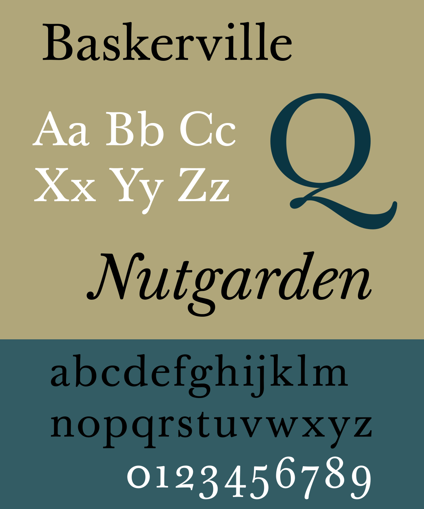

> Transitional or Neo-classical (sometimes stylized as Neoclassical) is a historical classification for typefaces that reference elements of human penmanship—à la Humanist faces. But they do so in a more ordered and structured form, usually with a higher stroke contrast, a more upright axis, and more symmetry.
> 

18th century was rich in new ideas and changes in typography and another masterpiece was created in France by the Didot family. Named Didot it was one of the first **Modern** serifs, defined by very thing serifs and very high contrast between thick and thin strokes.

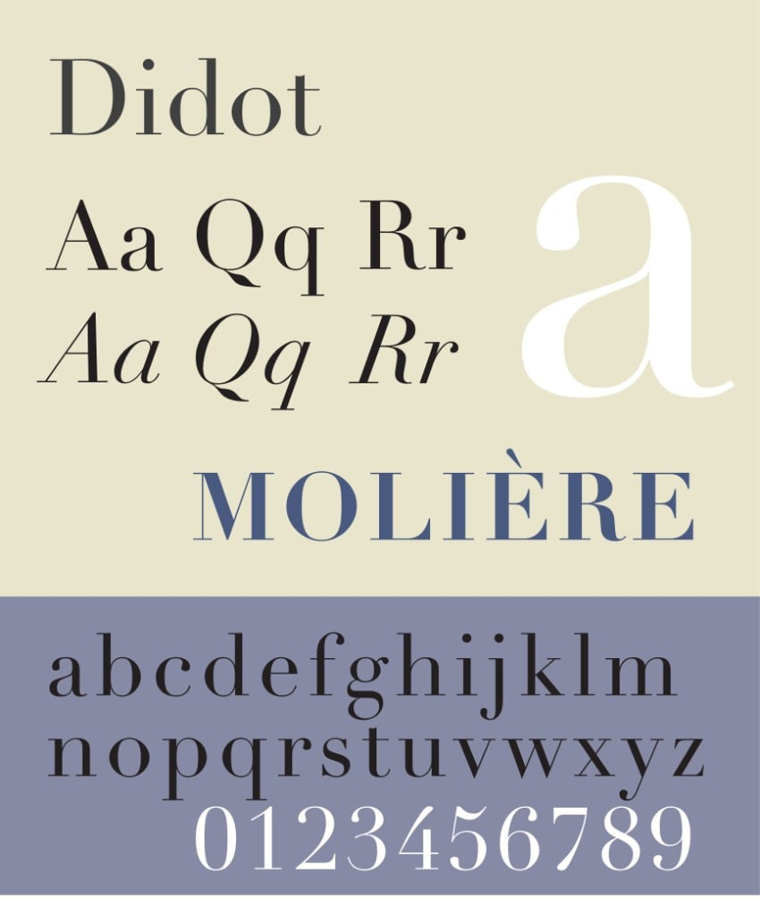

> Didone, or modern, serif typefaces, which first emerged in the late 18th century, are characterized by extreme contrast between thick and thin lines. These typefaces have a vertical stress and thin serifs with a constant width, with minimal bracketing (constant width).
> 

**Didot** typeface is widely considered to be especially elegant and chic so it’s one of the most used in the ads and media positioning itself as luxury.

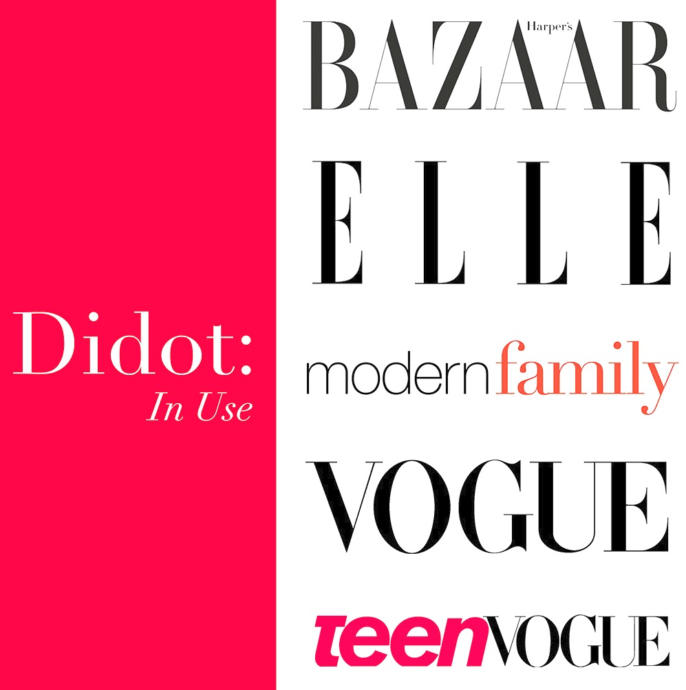

With industrial revolution happening in the 19th century and enormous progress in the technology and industry there was a need for something new in typography as well and results were dubious but recognisable, below is a typical example: 

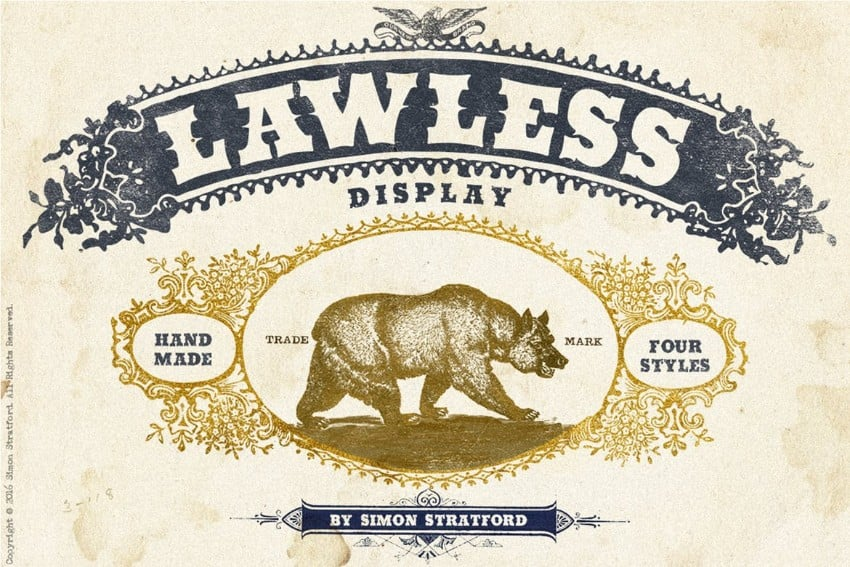

Beginning of 20th century brought in some fresh and elegant new design to typography. 

Sans serif fonts were making a statement. Probably the best-known early sans serif is **Futura** created by German typographer Paul Renner in 1927. He said that he was inspired by geometric shapes, which gave Futura similar fonts their group name: the **Geometric Sans** typefaces.

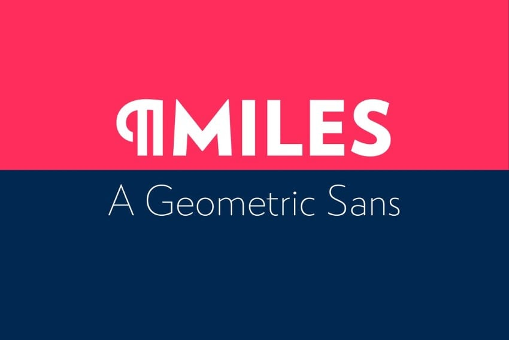

Another notable typeface was designed by Eric Gill, who crated yet one more **Modernist** classic named **Gill Sans**

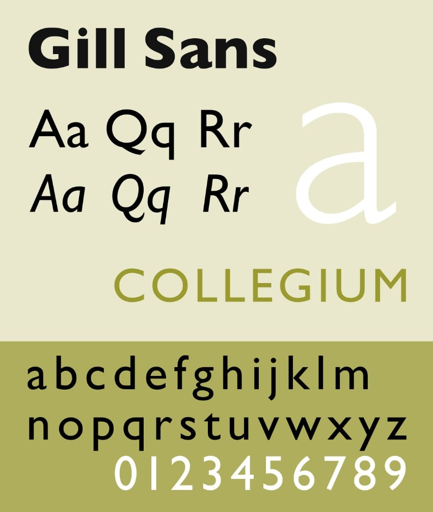

In the late 1950s in Switzerland a group of designers made another huge evolutionary step which was called the **Swiss Style** with distinctively ultra-legible type design and **Helvetica** typeface being a most known and popular part of it.

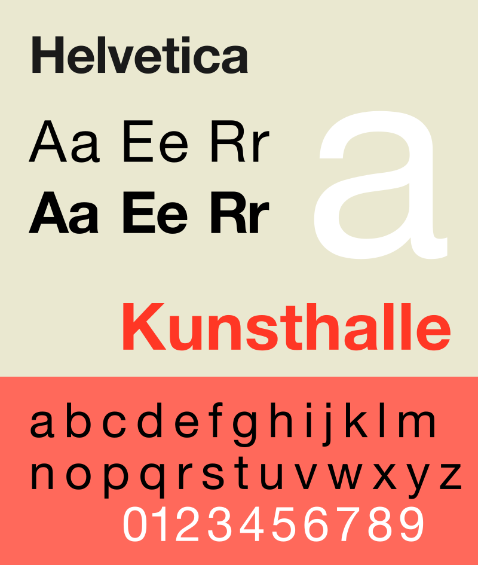

We can’t underestimated the importance of typography in our work. It can drastically affect usability, readability, accessibility, and hierarchy of our content.

Let’s get familiar with the most important concepts of typography.

## Typeface:

**A typeface is a set of characters of the same design, including letters, numbers, punctuation marks, and symbols**. A font presents a variation of a typeface. Fonts of a similar design compose a typeface.

For example Helvetica or Times New Roman are typefaces. Times New Roman Regular or Times New Roman Italic are fonts, 

## Tracking:

Tracking or letter-spacing is the horizontal spacing between the characters.

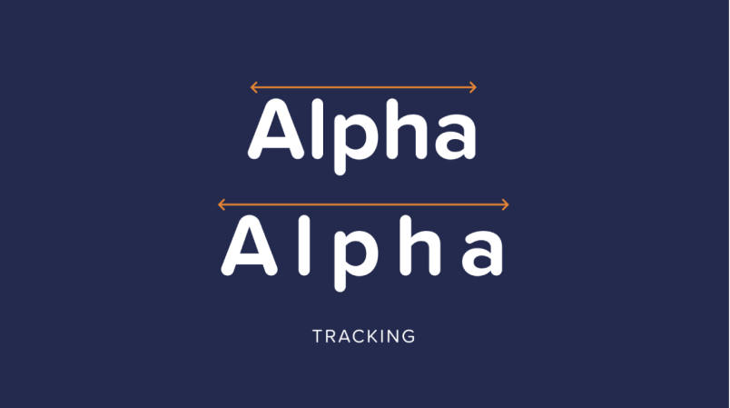

## Baseline:

The baseline is the line upon which a line of text is positioned upon.

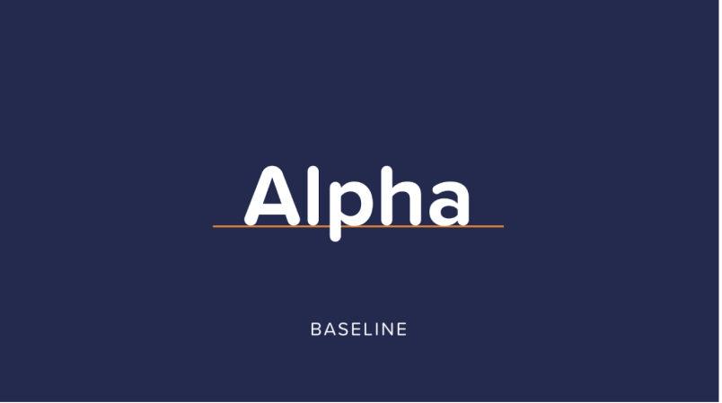

## Leading:

Leading or line-height is the vertical spacing between two baselines.

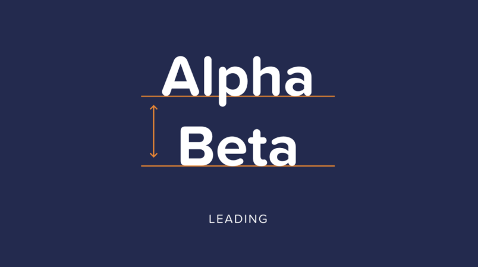

## Weight:

Weight is the relative thickness of a font’s stroke.

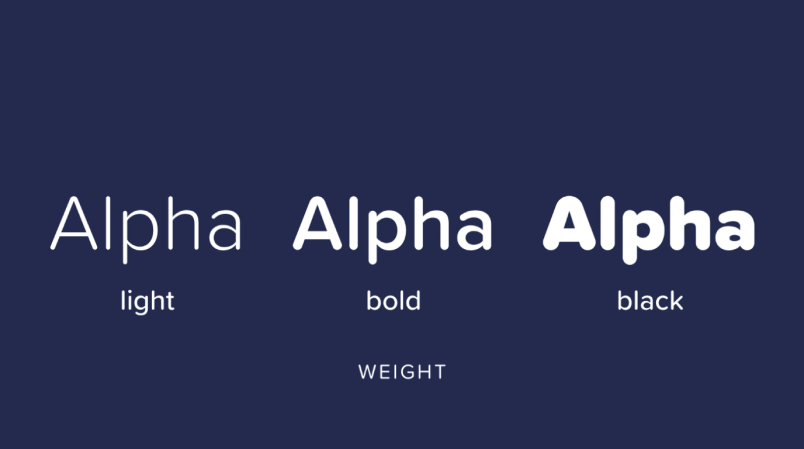

## Serif/ Sans Serif:

A serif is a small line or stroke. On the left is sans serif, on the right is serif.

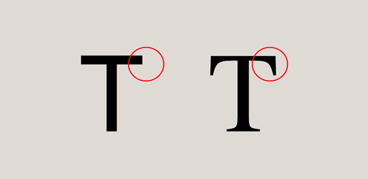

# Using typography

> To ensure our typography is easily readable and accessible to people with disabilities like color blindness, vision disabilities, hearing disabilities, and so on, we should follow [Web Content Accessibility Guidelines (WCAG)](https://www.w3.org/TR/2018/REC-WCAG21-20180605/).
> 

## Hierarchy

Hierarchy aimed at improving the scannability and readability by making it easier find important information quicker.

Bigger / bolder text is used to highlight the most important content, this is where readers eyes would be drawn to. Smaller / lighter text is used for less important content.

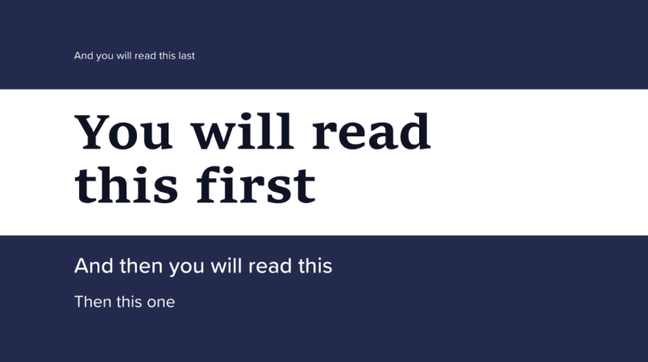

## Number of typefaces: less is better

Using too many different typefaces together can make our product look chaotic and sloppy. Instead of different typefaces try using different fonts of the same family so that you will have consistent but flexible look.

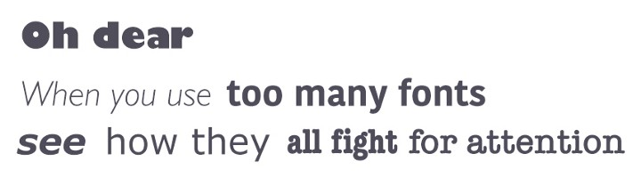

## Put emphasis on important content

We can use weight, size, color and their combination to highlight the more important parts of the text content. Lighter text for less important blocks, bolder or more vibrant for more important text.

## System fonts are not that bad!

All operating systems, mobile and desktop (iOS, Android, macOS, Windows, etc…) already come with the system fonts which support weights, sizes, styles, and different languages. Using them in our designs mean that we guarantee comfortable and accessible reading experience.

System fonts support Dynamic Type and the larger accessibility type sizes, which lets readers choose their preferred text size without breaking our font design.

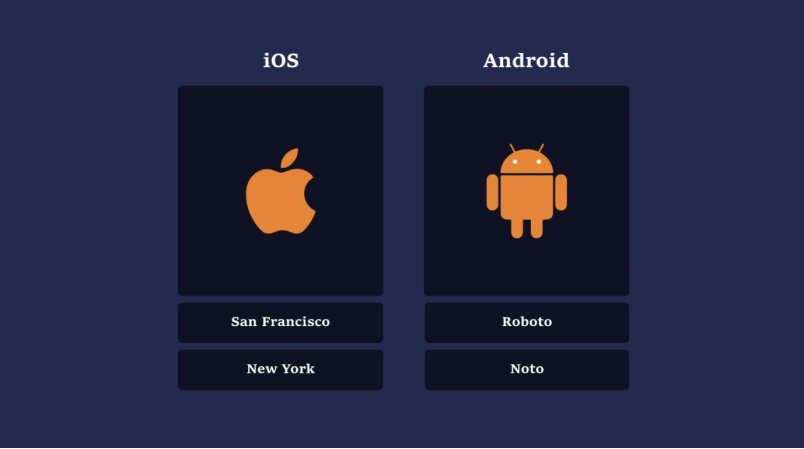
