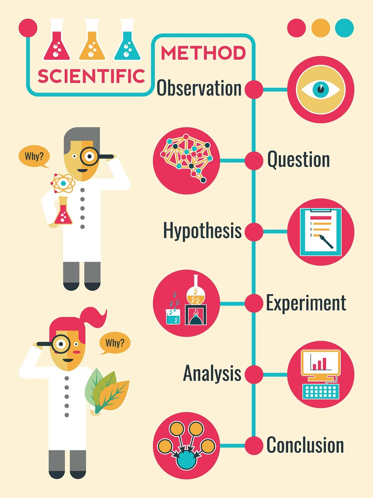
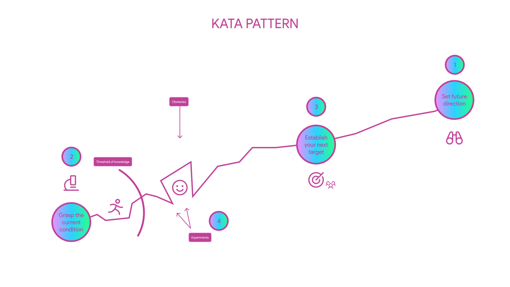
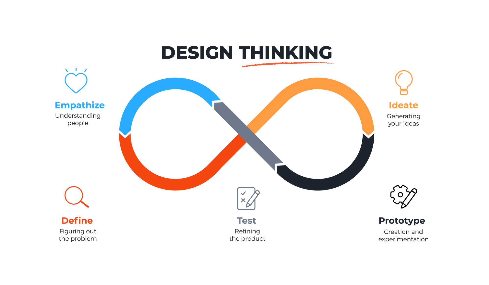
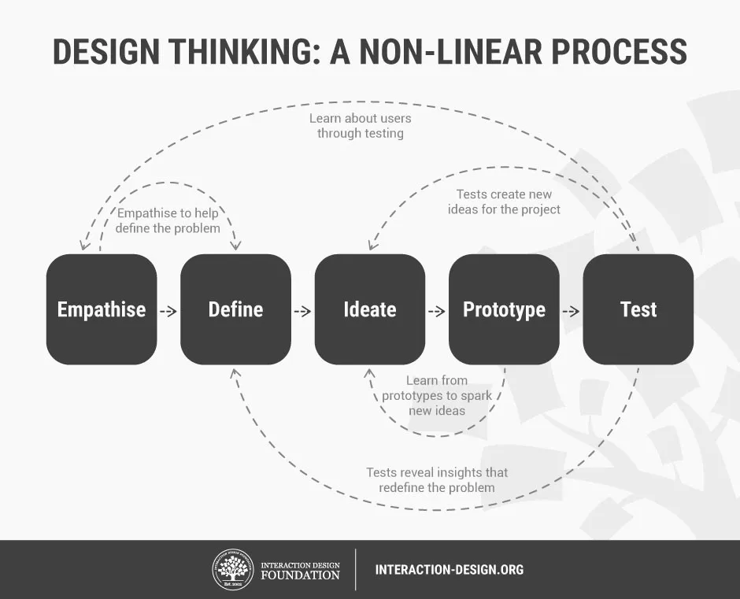
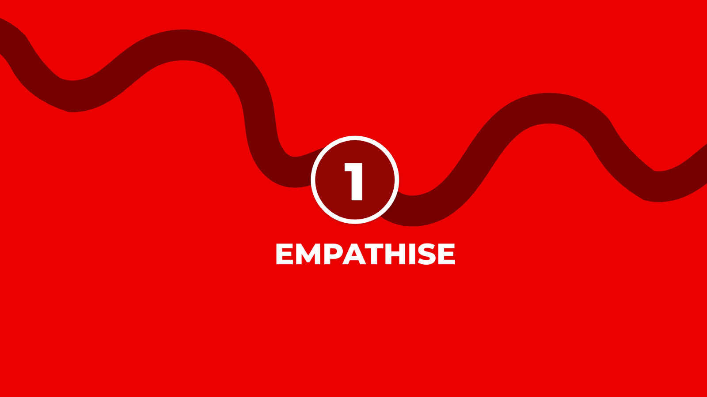
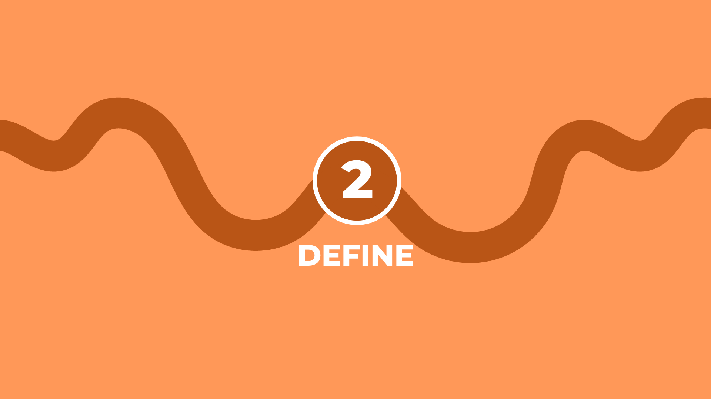
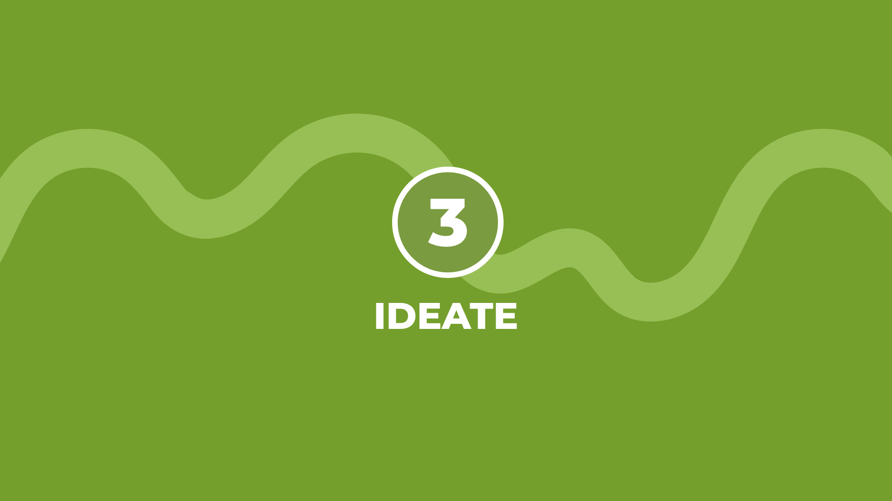
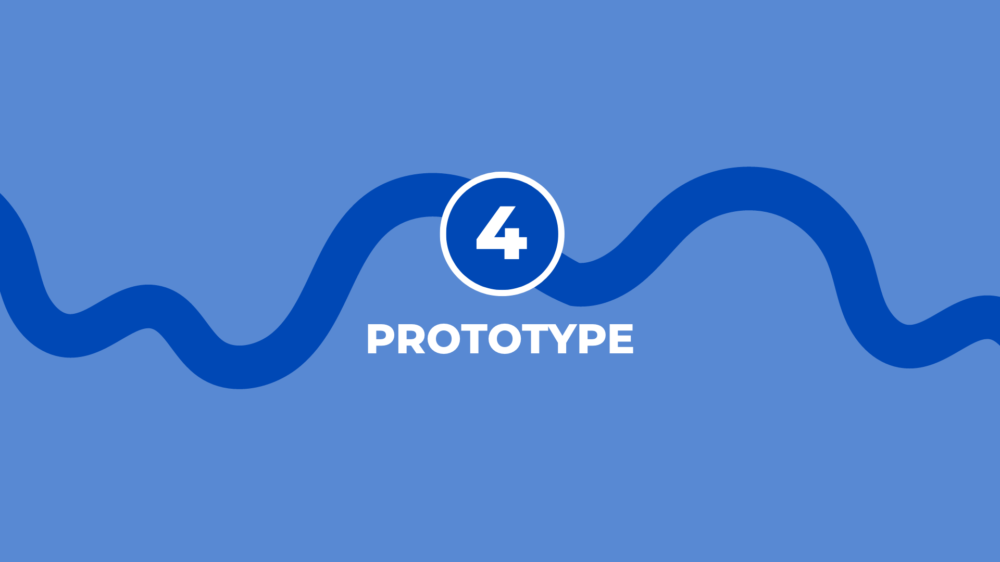
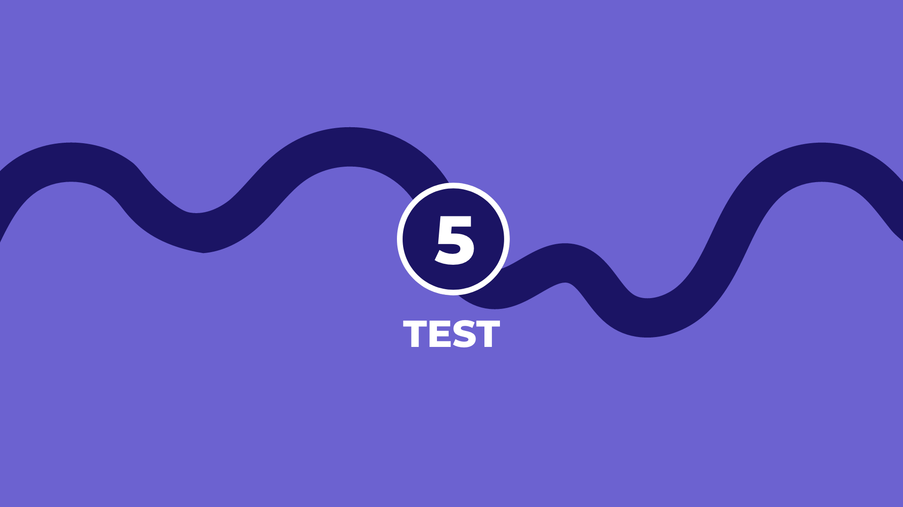
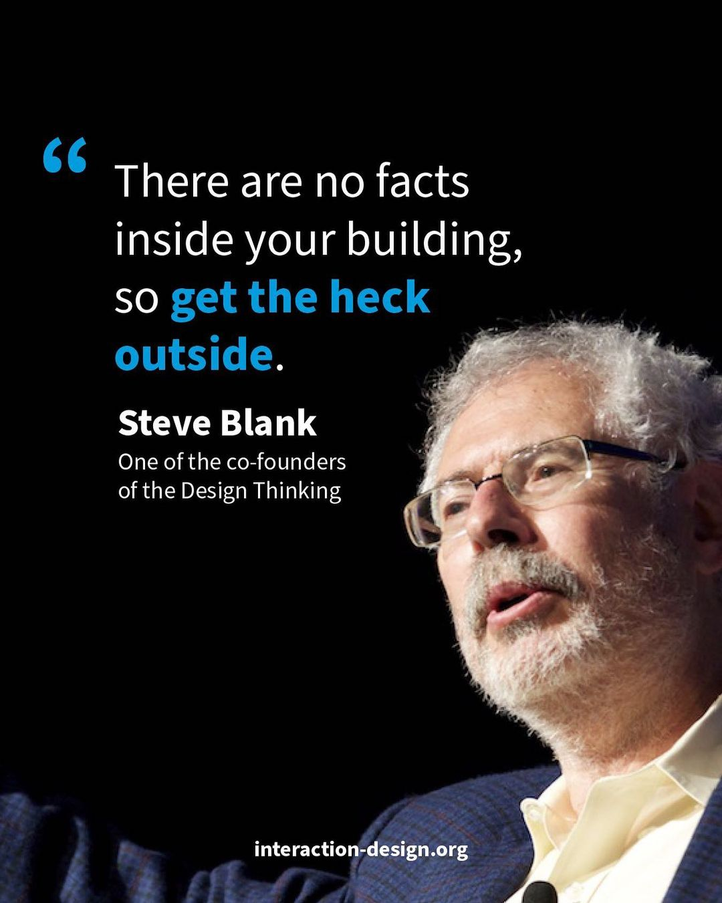

# What is Design Thinking

The entirety of your sprint will be developed around, and tuned towards a comprehensive understanding and application of **Design Thinking**. 

---

Design Thinking is a popular multi disciplined creative problem solving framework which borrows from a variety of market and industrial strategies to produce a solution to even some of the world’s toughest problems. Being said, it’s essentially based in science. 

This process is characteristically distinct from the formal definition of UX as an accessibility test and yet it is intimately linked. **Design Thinking is fundamentally preoccupied with understanding the user’s truth of their lived experience and real world interaction with a product or service**. 

It’s also used to assess market sectors. It’s important to understand the difference between UX and Design Thinking. On this course, you are expected to apply design thinking and apply good technical UX. 

DT starts with a process of investigation and it ends with your testing of a viable product which was, in essence, born out of an initial research phase. 

The steps in Agile Kata are often not sequential but rather cyclical or even interdependent, as teams may frequently revisit steps based on new insights, feedback, or evolving goals. This is true to how real world tangible results are made. Often through discovery, sometimes through setting a target, sometimes through trial and error.   

Your end product, which is a balance of creative thinking and applied analysis, is further refined into the same repeated process until it reaches a satisfactory completion stage. This process, is frequently characterised as scientific design (kind of) as we let the data influence our outcomes to make them stronger than just our own wild hunch. 

The expression DT, was initially popularised specifically by the Palo Alto design firm IDEO who played a significant role in bringing design thinking to prominence with devices like the original Apple 2 mouse. As mentioned. 

---

Design thinking emphasises understanding the needs, desires, and behaviours of the people who will use or be affected by a particular product, service, or system. By focusing on empathy and gaining deep insights into users, design thinking aims to create solutions that truly resonate with their intended audience.

---

## User Experience

It's from this framework that User Experience (UX) design is related as both approaches prioritise understanding and meeting the needs of users. 

Whereas Design Thinking is a comprehensive multi-disciplinary problem solving technique, UX design is a sole discipline which is usually kept within the parameters of interface design and it’s primarily concern with usability and enjoyment. 

You must fully understand the distinction between the technique of Design Thinking as a methodology and the discipline of UX and yet acknowledge their shared goals.

Lastly, Design Thinking shares great similarities with the Agile methodology, which is also an iterative and collaborative approach to project management and software development. 

On the course, you should be focused on both understanding and applying the framework of Design Thinking **and** learning the industry standard rules of UX.  

So, let’s explore the phases of Design Thinking;

Empathise: Often referred to as discovery, in this phase, designers aim to understand the needs, motivations, and pain points of the users to develop empathy and gain deep insights into the optimum solutions. 

Define: Once informed, designers begin to draw conclusions, synthesising findings and settling on a series of MVP’s which aim to produce the optimum product.

Ideate: Let the ideas go. This phase involves a series of iterative sequential steps, upping the fidelity from initial sketches until we arrive at a beautiful prototype.   

Prototype: Ideas are transformed into tangible representations that allow designers to test their intial assumptions. 

Test: Designers observe and analyse user interactions to learn how well the prototype meets their needs and expectations.

---

## Outcome

Understanding how problems are assessed and solutions are generated through the Design Thinking method will provide you with the requisite experience necessary to gain confidence in problem solving and iterating design. 

Learning the rules of UX will assist you usability and best design practices. We look forward to seeing your data driven design results    

Through this process you will learn how to design without assumption. You will carefully assess the user, the accuracy of the product and think through the core functionality before producing a prototype.

You will repeat this process and test it further to create the most accurate creative product you possibly can.

---

## Why it matters for UX

Design Thinking is the framework your whole sprint runs on. It keeps you from jumping to solutions: you understand people first, define the right problem, then build and test cheaply, and you loop back whenever you learn something new.

## Try it: a five-stage mini sprint (45 minutes)

1. Empathise: interview a classmate for 5 minutes about their morning routine.
2. Define: write one problem statement: "[Name] needs a way to … because …".
3. Ideate: sketch five different solutions in 10 minutes.
4. Prototype: make the best one on paper.
5. Test: show it to your classmate, and write down one thing to change.

## Media

[https://www.youtube.com/watch?v=sN_g8FnziLw](https://www.youtube.com/watch?v=sN_g8FnziLw)

## Resources

[Design Thinking 101 – Nielsen Norman Group](https://www.nngroup.com/articles/design-thinking/)

[IDEO Design Thinking](https://designthinking.ideo.com/)

## Key takeaways

- Design Thinking runs through five stages: empathise, define, ideate, prototype and test.
- The stages are a loop, not a line: go back whenever you learn something.
- Design Thinking is a problem-solving method; UX is the discipline you apply inside it.
