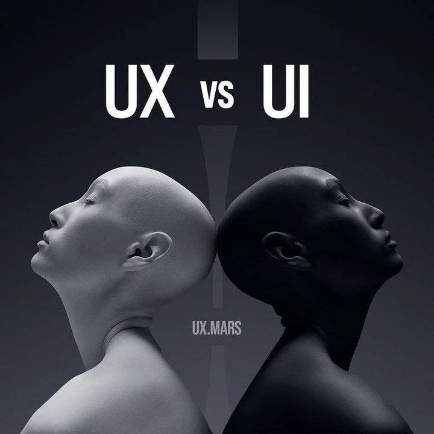
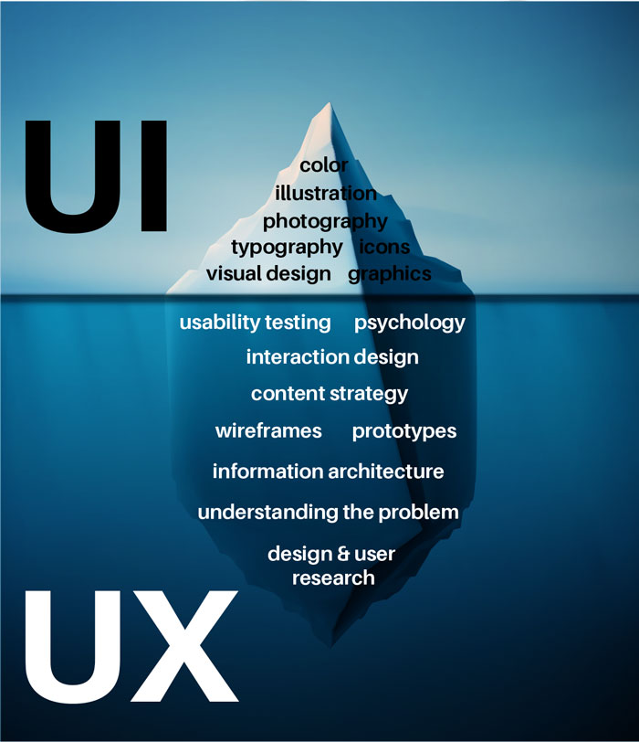
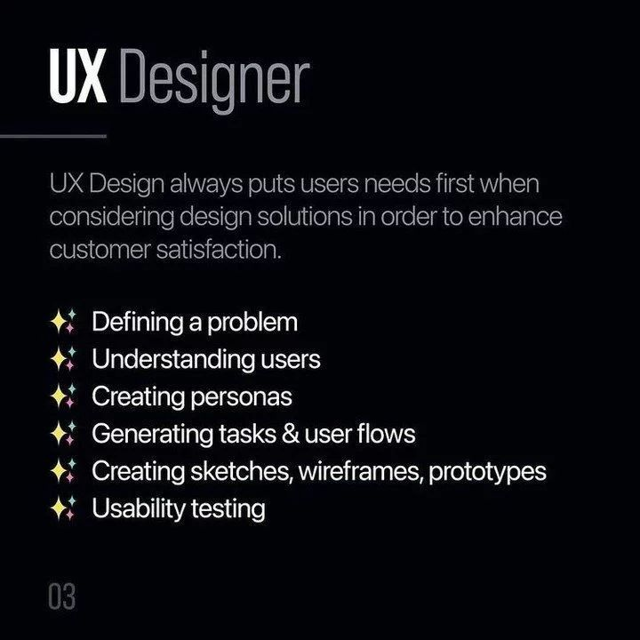
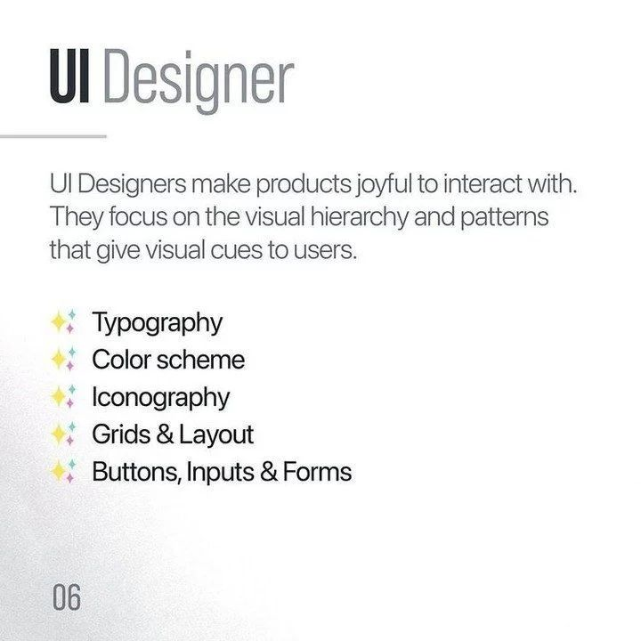
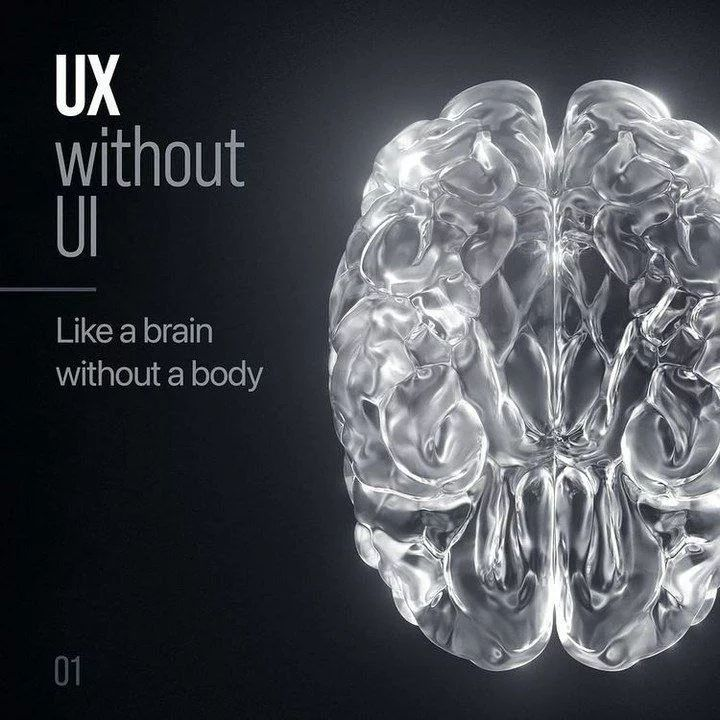
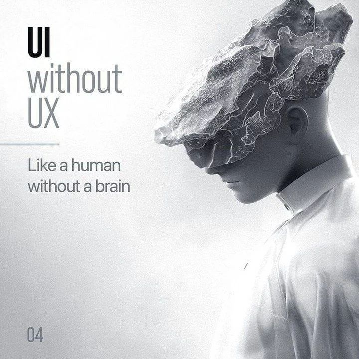
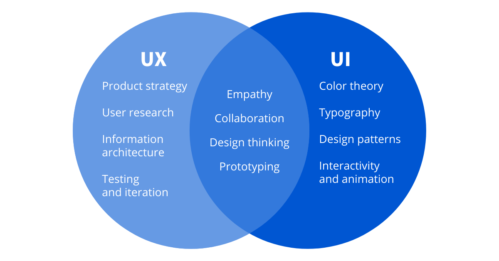
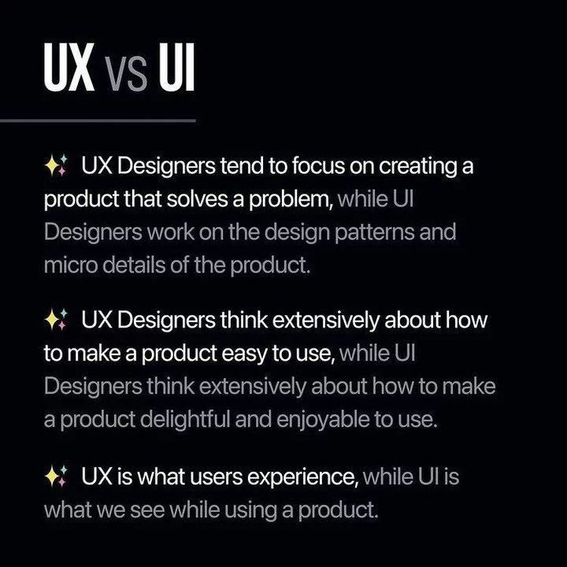
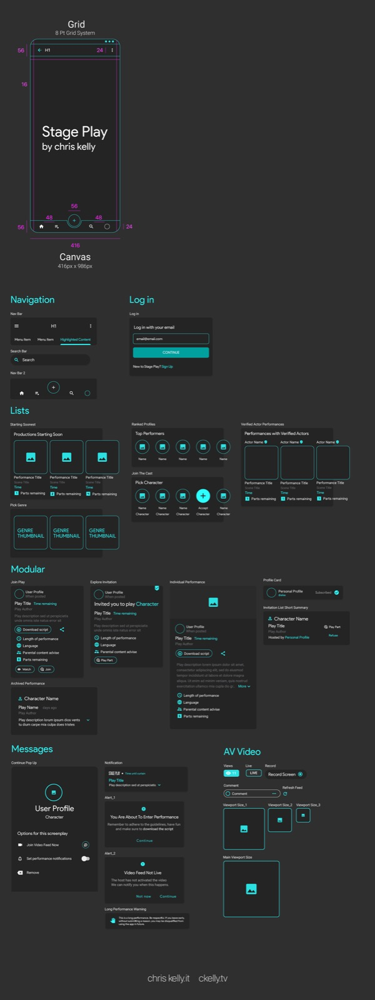

# What is UI Design

User Interface (UI) design primarily deals with the visual aspects of a digital product. It focuses on crafting the look and feel of the interface, including elements like buttons, icons, colors, typography, and layout. 

---

Where User Experience (UX) design is concerned with the overall experience of the user when interacting with a product, UI Designers work inside the console utilizsing softwares like Figma, Sketch or XD

. 

---

---

---

# Where they meet: It's About The User

---

While UI design and UX design are closely related and often overlap, they represent distinct aspects of the design process. UI design is more about the presentation layer, while UX design is about the entire user experience.

---

---

## UI Cornerstone Topics

[Icons](icons.html)

[Colors](colors.html)

[Typography](typography.html)

[Grid](grid.html)

[Design Systems](design-systems.html)
