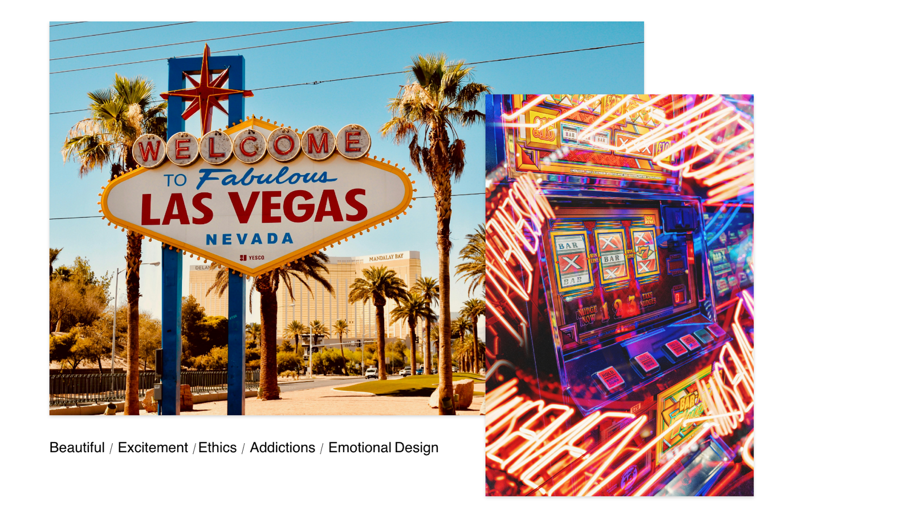

# What is UX Design

---

## Empathy first

UX Design has come to be understood as the process of providing enjoyable user experiences of software applications but in actuality, it is so much more. It is a total philosophy. User experience design is an ideology which starts and ends with one word. **Empathy.** 

*UX Design is design that creates happiness!*

Empathy is the english translation for the greek word páthos which means wound. In essence, to be a good user experience designer, you must be able to see the suffering of the user and commit yourself totally to healing the wounds.  

A good user experience designer, not only understands the needs of the user but actually steps into their shoes and totally adopts their experience in order to apply their design skills to improving the product. 

They abandon who they are and see the world through the lens of the user and one of the most important lessons to learn early as a UX designer is that you **are not the user.** 

---

You must talk to users, read about them, understand what they do and why they do it. You must realise that your users will have their own taste, their own likes and dislikes, their own proclivities, their own specific requirements and frequently, you will not share these tastes but you must learn to adopt their tastes. You must also be prepared for users to use your designs in ways you didn’t anticipate and be ready to adapt. You must learn to listen. In fact a good designer is constantly improving their designs. So you must really step into the shoes of someone you don’t know and understand, at a forensic level, who they are, what motivates them and what keeps them coming back. 

People are pretty complex and a good UX designer is good at reading people and capable of breaking down their complexities to produce a product that they like to use. They are able to see how we are all the same and yet we are all different because when it comes to groups, people behave in surprisingly similar ways.

---

It’s a fact that people look for what they like in this world. In truth, you may often find yourself drawn to producing services and products that you yourself enjoy but market forces are much broader than individual tastes and designers rarely fit the mould of the everyman.

> I'll look to like, if looking liking move.
> 

Juliet, Romeo and Juliet. 

You must understand the user. This is what makes a good user experience designer. Equally you must be able to, as mentioned, recognise that whist people are characteristically different, we are all essentially the same and what is constant is we all expect a certain level of efficiency and excellence from the services we use. 

A good designer practices attention to detail and they will be aware of the total system design, the entire pipeline and work to constantly improve every aspect of it.  

---

## Walt Disney

Arguably the greatest UX designer of all time. Walt Disney was a visionary whose attention to detail and boundless imagination changed the meaning of the word immersive experience. The success that Walt Disney achieved with his iconic Mickey Mouse and Co, encompasses the very reason why people see the intense value in creating a total system. 

[https://www.youtube.com/watch?v=_30jPKzWdN0](https://www.youtube.com/watch?v=_30jPKzWdN0)

It all starts with care and empathy and being able to put yourself into the shoes of the customer.  

---

## Why it matters for UX

Everything else in this course, from research methods to Figma components, is a way of acting on empathy. If you skip it, you design for yourself, and you are not the user. Teams that start from real people's needs build products people keep coming back to.

## Try it: walk in someone else's shoes (30 minutes)

1. Pick a service you use often, such as a supermarket app or your bank, and a person who is not like you: an older relative, a child or a first-time visitor.
2. Write down three things that person needs from the service and three things that would frustrate them.
3. Go through one task in the service as if you were them, and note every point where they would hesitate.
4. Pick the worst moment and write one sentence on how you would fix it.

## Media

[https://www.youtube.com/watch?v=DTr3naujzqs](https://www.youtube.com/watch?v=DTr3naujzqs)

[https://www.youtube.com/watch?v=YIkSapg2XH8](https://www.youtube.com/watch?v=YIkSapg2XH8)

## Resources

[The Definition of User Experience (UX) – Nielsen Norman Group](https://www.nngroup.com/articles/definition-user-experience/)

[Sympathy vs. Empathy in UX – Nielsen Norman Group](https://www.nngroup.com/articles/sympathy-vs-empathy-ux/)

## Key takeaways

- UX design starts and ends with empathy: seeing the world through the user's eyes.
- You are not the user. Talk to users and expect them to surprise you.
- Good experiences come from attention to the whole system, as Disney showed, not just the screen.
