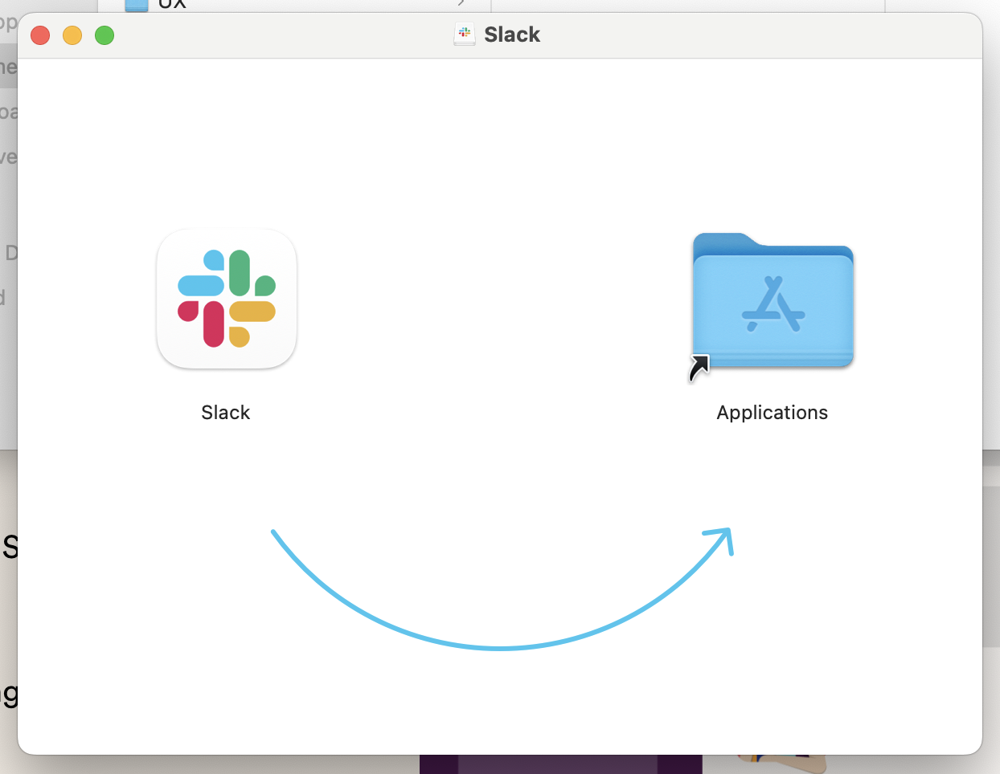
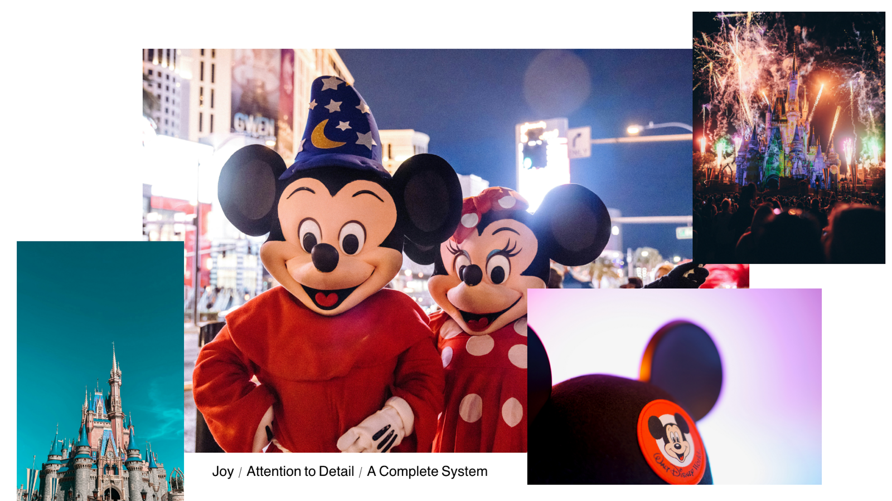
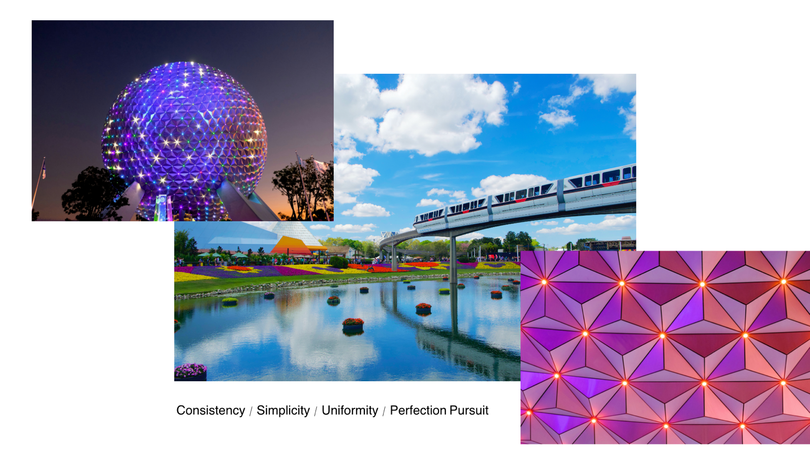

title: What is UX Design
promise: UX design starts and ends with one word: empathy. Why you are not the user, and why the best experiences are designed as a whole system.
duration: 10 minutes
topics:
- More than making software enjoyable
- Empathy first
- You are not the user
- People are different, and the same
- Walt Disney and the total system
---
@title
# What is UX Design
It starts and ends with one word: empathy.
---
@statement
UX design isn't only about enjoyable software.

It covers **every part** of someone's interaction with a company, its services and its products.
---
@split
## Design that creates happiness

One drag, one arrow, no instructions needed.

Good UX feels obvious, because someone worked hard to make it so.
---
@statement
**Empathy.**

From the Greek *pathos*: suffering. See what hurts for your users, and commit to fixing it.
---
@text
## Step into their shoes

A good UX designer doesn't just understand users' needs. They **adopt their experience**.

Talk to users. Read about them. Watch what they do and ask why they do it.

Expect them to use your design in ways you never planned, and be ready to adapt.
---
@statement
The most important lesson of all:

**You are not the user.**
---
@text
## Their taste, not yours

Your users have their own tastes, habits and needs, and often you won't share them.

You'll be drawn to making things **you** enjoy. But markets are far broader than one person's taste, and designers rarely fit the mould of the everyman.
---
@text
## Different, and the same

Everyone is different. And yet in groups, people behave in surprisingly similar ways.

What's constant is that we all expect a certain level of **efficiency and excellence** from the services we use.
---
@split
## Walt Disney

Arguably one of the greatest experience designers of all time.

Films, characters, parks, queues, staff: every detail served **one story**.
---
@split
## A total system

Disney showed the value of designing the **whole system**, not just one part.

Good designers pay attention to the entire pipeline, and keep improving every piece of it.
---
@exercise
## Walk in their shoes

Three people use the same **supermarket app**:

1. **Carmen**, 78, on her first smartphone
2. **Jordi**, 34, shopping one-handed on a crowded bus
3. **Amira**, visiting from Morocco, who reads little Spanish

For each, write one thing they **need** and one thing that would **frustrate** them.
---
@answers
## Some possible answers

1. **Carmen** needs large text and clear labels, not icons alone. She'd be frustrated by tiny buttons and a timed-out session
2. **Jordi** needs the key actions within reach of his thumb. He'd be frustrated by a reorder button at the top of the screen
3. **Amira** needs a language choice and product photos. She'd be frustrated by text-only lists in Spanish

Three people, one app. None of them is you.
