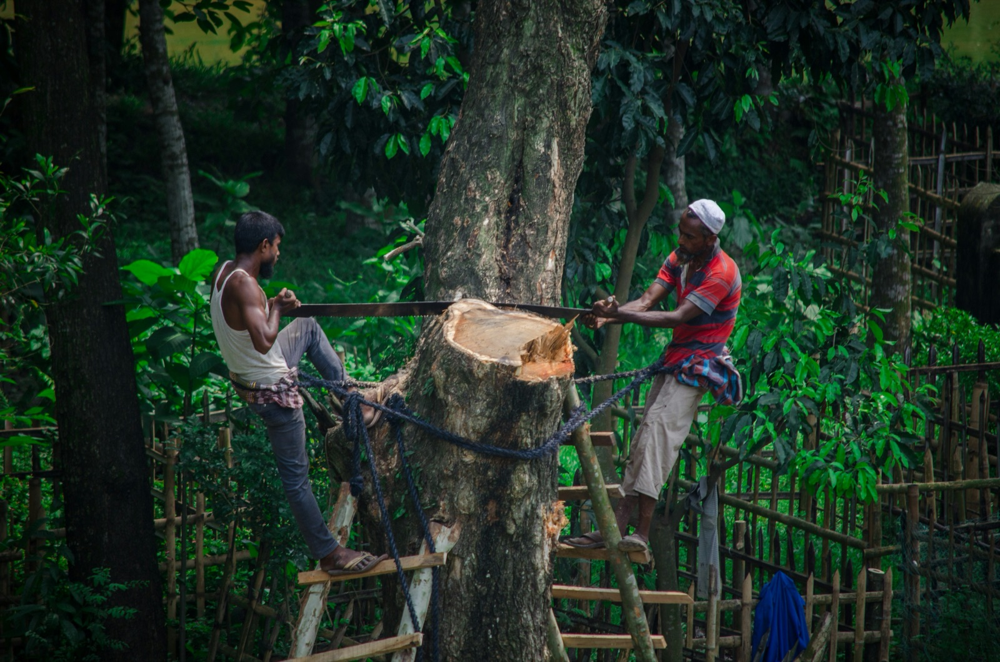

title: Wicked Problem
promise: Some problems can't be solved, only dented. How to recognise a wicked problem, and how to narrow it to a dent your design can make.
duration: 10 minutes
topics:
- What makes a problem wicked
- Examples from climate to inequality
- The five factors
- Mapping a wicked problem
- Narrowing it to a small dent
---
@title
# Wicked Problem
You can't solve it. You can make a dent.
---
@statement
A **wicked problem** is hard or impossible to solve, because its requirements are incomplete, contradictory and always changing.

Solve one part, and you reveal or create others.
---
@split
## Systemic

Deforestation isn't one problem. It's jobs, land, food, money, laws and habits, all tangled together.

There's no single solution and **no stopping point**.
---
@cards
## Wicked problems you know

- **Climate** Global warming, fossil fuels, biodiversity loss
- **People** Forced migration, refugee crises, war
- **Money** Wealth inequality, energy insecurity, famine
- **Health** Pandemics, obesity, plastic in our food chain
---
@text
## Closer to home

Spain's economy depends heavily on **tourism**.

Without tourists, the country would lose a huge part of its income. With them come rising rents, crowded neighbourhoods and environmental damage.

Every fix helps someone and hurts someone else.
---
@cards
## Five factors of a wicked problem

- **Operationally complex** Many moving parts
- **No single solution** Only better and worse responses
- **Unforeseen outcomes** Every fix has side effects
- **Behavioural change** People have to act differently
- **Interdependent** Every cause is tied to others
---
@image
## Map it as a web, not a line

*Wicked Problem Mapping, created by a former student investigating world hunger: the 5 Whys, drawn as a web of causes.*
---
@statement
You'll never solve a wicked problem.

But you can **chip away** at a small part of it, and a small difference can go a long way.
---
@text
## Narrow it early

If your case study touches a wicked problem, **focus in** as early as you can.

Find one cause small enough for one product to help, then spend your discovery on the users and market around it.
---
@exercise
## Wicked or just hard?

1. A booking app for a hair salon
2. Food waste in Barcelona
3. Landing a rocket on the Moon
4. Loneliness among older people in cities
5. Overcrowded tourist hotspots in your city

For each wicked one: name **one small dent** a product could make.
---
@answers
## Check yourself

1. **Hard, not wicked.** Clear requirements, and you know when it's done
2. **Wicked.** Shops, homes, farms, habits and laws all play a part. *A dent:* an app that sells end-of-day food from bakeries cheaply
3. **Hard, not wicked.** Enormously complex, but the goal is clear and fixed
4. **Wicked.** Housing, health, family and transport are all tied in. *A dent:* a service matching students with older neighbours for weekly walks
5. **Wicked.** Every fix helps some people and hurts others. *A dent:* live crowd levels that nudge visitors to quieter times and places
